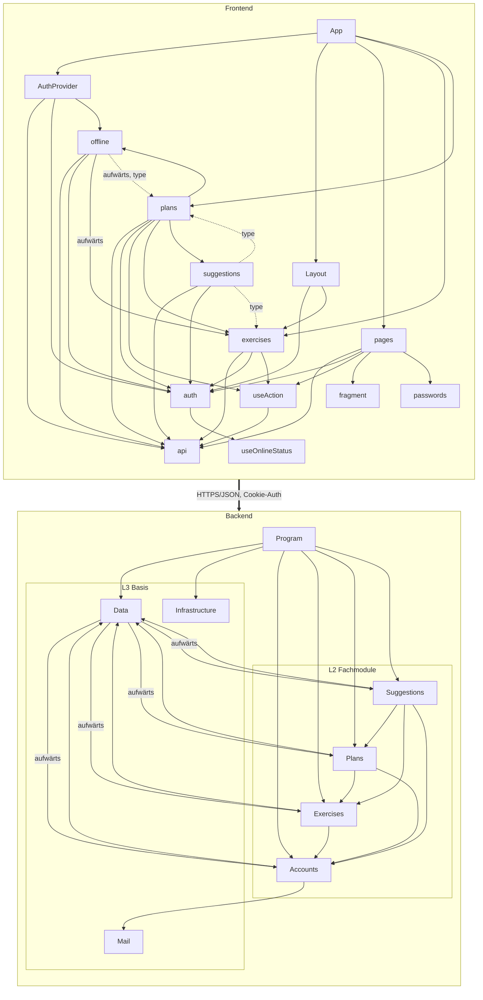

# Architektur-Review CoachFlow

Stand: 14.11.2026

**Untersuchte Grundlage:** alle 27 handgeschriebenen `.cs`-Dateien unter `src/CoachFlow.Api` (2.336 Zeilen), alle 29 `.ts/.tsx`-Dateien unter `src/coachflow-web/src` (2.445 Zeilen ohne Tests), außerdem `Dockerfile`, `.github/workflows/ci.yml`, `vite.config.ts`, `README.md` und der Migrations-Snapshot. Nicht gezählt wurden die generierten Migrationen, `bin/`, `obj/` und `wwwroot/` (Build-Ausgabe) sowie die Tests.

Die Abhängigkeiten wurden per Skript gemessen und jede Kante von Hand nachgeprüft. Gezählt werden echte Typverweise, nicht nur `using`-Zeilen, weil C# Nachbar-Namespaces auch ohne `using` erreicht (z. B. `Accounts.AppUser`). Die Kanten `Program → Exercises/Plans/Suggestions` entstehen nur über Extension-Methoden und wurden manuell erhoben (`Add/Map/Use…`-Aufrufe in `Program.cs:22-54`).

---

## 1. Architekturbeschreibung

### 1.1 Systemkontext

CoachFlow ist eine Web-App für die Planung von Volleyballtrainings. Ein einziger Container liefert die API und das React-Frontend aus.

| Akteur / Fremdsystem | Beziehung | Beleg |
|---|---|---|
| **Trainer:innen** (eingeladene Konten) | Browser oder installierte PWA, HTTPS/JSON | `App.tsx`, `AccountEndpoints.cs` |
| **Betreiber:in** | Legt das erste Konto per Kommandozeile an (`dotnet CoachFlow.Api.dll invite <mail>`) | `Program.cs:33`, `AccountCommands.cs` |
| **SMTP-Dienst** | Versendet Einladungen und Passwort-Reset-Mails | `MailSenders.cs`, `AccountSetup.cs:85-103` |
| **SQLite-Datei** | Eingebettete DB auf einem Volume (`/data`) | `Dockerfile`, `SqliteDatabase.cs` |
| **Externe KI-API** | **Noch nicht angebunden.** Es gibt nur die Provider `None` und `Test`; jeder andere Wert bricht den Start ab | `SuggestionSetup.cs:15-27` |
| **Hosting-Plattform** | Stellt HTTPS bzw. Reverse Proxy bereit | `README.md` (Abschnitt Betrieb) |

### 1.2 Bausteinsicht

**Backend: ASP.NET Core 10, Minimal APIs, ein Projekt**

| Komponente | Verantwortung |
|---|---|
| **Program** | Composition Root. Registriert die Module über `Add…/Map…`-Extensions, führt die Migration beim Start aus und behandelt das CLI-Kommando `invite`. |
| **Accounts** | Einladungen, Login, Logout, Passwort-Reset, Cookie-Auth, Rate-Limit für Auth-Endpunkte. Enthält die Entität `AppUser`, die alle anderen Module verwenden. |
| **Exercises** | Übungen und Schwerpunkte (Focus): CRUD, Filter, Seed-Katalog. Enthält außerdem die Hilfsklasse `Text` und die Validierungskonstanten (`ExerciseEndpoints.Max*`). |
| **Plans** | Trainingspläne mit Positionen. Beim Speichern wird der Stand der Übung in die Position kopiert; Versionierung schützt gegen gleichzeitiges Überschreiben. |
| **Suggestions** | KI-Übungsvorschläge: Port `IExerciseSuggestionProvider`, Test-Adapter, Parser, Prompt, Limit pro Person (im Speicher), Monatsbudget, Erfassung der Nutzung. |
| **Data** | Der zentrale `AppDbContext` mit allen Entitäten und Mappings, dazu SQLite-Pfad, Migration und WAL-Modus. |
| **Mail** | Port `IMailSender` mit drei Adaptern: SMTP, Log (Entwicklung) und „nicht konfiguriert“. |
| **Infrastructure** | Health-Checks (`/health/live`, `/health/ready`), Auslieferung der SPA mit Cache-Regeln, Fallback auf `index.html`. |

**Frontend: React 19, React Router 8, Vite-PWA**

| Komponente | Verantwortung |
|---|---|
| **App** (`App.tsx` und `main.tsx`) | Einstieg und Routing-Tabelle. |
| **Layout** | Navigationsgerüst und Routen-Wächter (`RequireAccount`, `RequireAnonymous`). |
| **AuthProvider** | Sitzungszustand: online, offline, nicht erreichbar oder anonym. Frischt die Offline-Kopie nach dem Login auf. |
| **pages/** | Seiten rund ums Konto: Login, Einladung, Passwort, Startseite mit Einladen. |
| **exercises/** | Übungsliste, Bearbeiten, `FocusPicker`, Modell. Das Modell enthält auch die allgemeine Funktion `formatDateTime`. |
| **plans/** | Planliste, Ansicht, Editor (436 Zeilen), `ExercisePicker`, Modell. |
| **suggestions/** | Vorschlagspanel und Anfrage-Logik mit 5 s Hinweis und 15 s Abbruch. |
| **offline/** | Lesekopie aller Pläne in IndexedDB (`planCopy`) und der UI-Hinweis `OfflineNotice`. |
| **api** | Dünner `fetch`-Client mit Auswertung der ProblemDetails (`ApiError`). |
| **auth** | Auth-Context, `useAuth`, `useConnected`. |
| **useAction, useOnlineStatus, fragment, passwords** | Kleine Hilfen: Formularablauf, Online-Status, URL-Fragment lesen, Passwortregeln. |

### 1.3 Schichtenmodell

Im Code gibt es keine ausdrücklich benannten Schichten. Das folgende Modell ist aus der Struktur abgeleitet und dient als Referenz für die Metriken.

| Schicht | Backend | Frontend |
|---|---|---|
| L1 Einstieg / Shell | Program | App, Layout, AuthProvider |
| L2 Fachmodule | Accounts, Exercises, Plans, Suggestions | pages, exercises, plans, suggestions |
| L3 Technische Basis | Data, Mail, Infrastructure | api, auth, offline, useAction, useOnlineStatus, fragment, passwords |

Innerhalb der Backend-Module gibt es keine eigene Anwendungs- oder Service-Schicht. Die Endpoint-Handler validieren selbst, enthalten die Geschäftsregeln und greifen direkt auf `AppDbContext` zu (Transaction Script). Eine Ausnahme ist `InvitationService`.

### 1.4 Architekturstile und Muster

| Stil / Muster | Begründung (Beleg) |
|---|---|
| **Modularer Monolith** | Ein Deployable (`Dockerfile`, eine `.csproj`), Module nach Fachlichkeit getrennt (`Accounts/`, `Exercises/` …). Die Grenzen sind allerdings **nicht erzwungen**: ein gemeinsames Assembly, 70 von 74 Typen sind `public`, und es gibt einen gemeinsamen DbContext. |
| **Vertical Slices / Feature-Ordner** | Jedes Modul bündelt Endpunkte, DTOs, Modell und Logik, im Frontend ebenso (`plans/`, `exercises/`). |
| **Ports & Adapters, nur punktuell** | `IExerciseSuggestionProvider` mit Test- und Disabled-Adapter, `IMailSender` mit drei Adaptern. Die Auswahl erfolgt per Konfiguration. Das ist **keine** durchgängig hexagonale Architektur, weil die Persistenz nicht hinter einem Port liegt. |
| **Transaction Script und EF Core als Unit of Work** | Die Logik steht in statischen Handler-Methoden (`PlanEndpoints.ApplyAsync`); Repositories gibt es nicht. |
| **Optimistic Concurrency** | `Version` als Concurrency-Token; bei Konflikt antwortet die API mit 409 und liefert in `current` den aktuellen Stand mit. |
| **Snapshot-Kopie** | `PlanPosition` kopiert Name und Beschreibung der Übung (`PlanEndpoints.cs:249-257`). |
| **SPA/PWA mit Offline-Lesekopie** | Workbox speichert nur die App-Dateien; Plandaten liegen gezielt in IndexedDB (`planCopy.ts`). |
| **Context Provider und Custom Hooks** | `AuthProvider`, `useAuth`, `useAction`. MVC liegt **nicht** vor. |

### 1.5 Kommunikation Frontend ↔ Backend

- **REST-artig, JSON über HTTP(S)** mit `fetch` und gleichem Ursprung (`api.ts`). Kein GraphQL, keine Events, keine WebSockets.
- **Auth:** HttpOnly-Cookie mit `SameSite=Strict` (`AccountSetup.cs:53-73`); bei fehlender Anmeldung 401 statt Redirect.
- **Fehler:** RFC-7807-ProblemDetails, die das Frontend in `ApiError` übersetzt.
- **Abbruch:** Ein `AbortSignal` im Frontend landet im Backend als `RequestAborted` und wird als `Cancelled` in der Nutzung erfasst.
- **Einige RPC-artige Endpunkte**, z. B. `POST /api/account/invitation` für einen Lesezugriff, damit der Token nicht in der URL steht.
- **Kein maschinenlesbarer Vertrag:** kein OpenAPI-Paket in der `.csproj`. Die DTOs sind in TypeScript von Hand nachgebaut (`exercises/model.ts`, `plans/model.ts`).
- **Abdeckung:** Alle 22 `/api`-Endpunkte werden vom Frontend aufgerufen (per `grep` geprüft). Es gibt keine ungenutzten Endpunkte.

---

## 2. Metriken

### Definitionen

- **Komponente Backend:** Namespace bzw. Ordner der obersten Ebene unter `CoachFlow.Api`. `Program.cs` zählt als eigene Komponente.
- **Komponente Frontend:** Ordner der obersten Ebene unter `src/`. Dateien direkt in `src/` zählen je Datei als Komponente; `main.tsx` ist mit `App.tsx` zusammengefasst.
- **Kante A → B:** A verwendet mindestens einen Typ oder Member von B. Im Frontend zählt jeder relative `import`, auch `import type`.
- **Ca** = Anzahl Komponenten, die von dieser Komponente abhängen. **Ce** = Anzahl Komponenten, von denen sie abhängt.
- **I** = Ce / (Ca + Ce).
- **A** = (Interfaces + abstrakte Klassen) / alle deklarierten Typen. Gezählt werden Klassen, Records, Enums und Interfaces einschließlich verschachtelter Typen. Statische Klassen gelten als konkret.
- **D** = |A + I − 1|.

### 2.1 Metrik-Tabelle Backend

| Komponente | Schicht | Ca | Ce | I | A | D | Zyklen | Belege |
|---|---|---|---|---|---|---|---|---|
| Program | L1 | 0 | 6 | 1,00 | 0/1 = 0 | 0,00 | – | Ce: Accounts, Data, Exercises, Infrastructure, Plans, Suggestions (`Program.cs:2-7, 12-54`) |
| Accounts | L2 | 5 | 2 | 0,29 | 0/17 = 0 | **0,71** | 8 | Ce: Data (`AppDbContext`), Mail (`IMailSender`, `OutgoingMail`, `SmtpOptions`, 3 Sender). Ca: Data, Exercises, Plans, Suggestions (alle über `AppUser`), Program |
| Exercises | L2 | 4 | 2 | 0,33 | 0/13 = 0 | **0,67** | 8 | Ce: Data, Accounts (`AppUser`). Ca: Data, Plans, Suggestions, Program |
| Plans | L2 | 3 | 3 | 0,50 | 0/8 = 0 | 0,50 | 8 | Ce: Data, Accounts, Exercises (`Focus`, `Level`, `Sports`, `Text`, `FocusResponse`, `ExerciseEndpoints.MaxParticipants/MaxDurationMinutes/ToResponse`). Ca: Data, Suggestions, Program |
| Suggestions | L2 | 2 | 4 | 0,67 | 1/24 = 0,04 | 0,29 | 8 | Ce: Data, Accounts, Exercises (`Level`, `Text`, `ExerciseEndpoints.*`), Plans (`Spread`, `TrainingPlan.MaxFocuses`, `PlanEndpoints.MaxDurationMinutes`). Abstrakt: `IExerciseSuggestionProvider` |
| **Data** | L3 | **5** | **4** | 0,44 | 0/3 = 0 | 0,56 | **15 (alle)** | Ce: Accounts (`AppUser`, `Invitation`), Exercises (`Exercise`, `Focus`, `FocusCatalog`, `ExerciseEndpoints`), Plans (`TrainingPlan`, `PlanPosition`, `PlanEndpoints`), Suggestions (`AiUsage`) (`AppDbContext.cs:1-131`) |
| Mail | L3 | 1 | 0 | 0,00 | 1/6 = 0,17 | **0,83** | – | Ca: Accounts. Abstrakt: `IMailSender` |
| Infrastructure | L3 | 1 | 0 | 0,00 | 0/2 = 0 | **1,00** | – | Ca: Program |

### 2.2 Metrik-Tabelle Frontend

| Komponente | Schicht | Ca | Ce | I | A | D | Zyklen | Belege (Ce) |
|---|---|---|---|---|---|---|---|---|
| App | L1 | 0 | 5 | 1,00 | n. e.¹ | n. e. | – | AuthProvider, Layout, pages, exercises, plans |
| Layout | L1 | 1 | 2 | 0,67 | n. e. | n. e. | – | auth, exercises (`formatDateTime`) |
| AuthProvider | L1 | 1 | 3 | 0,75 | n. e. | n. e. | – | api, auth, offline |
| pages | L2 | 1 | 5 | 0,83 | n. e. | n. e. | – | api, auth, fragment, passwords, useAction |
| exercises | L2 | **5** | 3 | 0,38 | n. e. | n. e. | – | api, auth, useAction. Ca: App, Layout, offline, plans, suggestions |
| **plans** | L2 | **3** | **6** | 0,67 | n. e. | n. e. | Z-F1, Z-F2 | api, auth, exercises, offline, suggestions, useAction |
| suggestions | L2 | 1 | 4 | 0,80 | n. e. | n. e. | Z-F2 | api, auth, exercises (type), plans (type) |
| offline | L3 | 2 | 4 | 0,67 | n. e. | n. e. | Z-F1 | api, auth, exercises (`OfflineNotice.tsx`), plans (type `Plan`) |
| api | L3 | **7** | 0 | 0,00 | 0/1 = 0 | 1,00 | – | Ca: AuthProvider, pages, exercises, plans, suggestions, offline, useAction |
| auth | L3 | **7** | 1 | 0,13 | n. e. | n. e. | – | useOnlineStatus |
| useAction | L3 | 3 | 1 | 0,25 | n. e. | n. e. | – | api |
| useOnlineStatus | L3 | 1 | 0 | 0,00 | n. e. | n. e. | – | – |
| fragment | L3 | 1 | 0 | 0,00 | n. e. | n. e. | – | – |
| passwords | L3 | 1 | 0 | 0,00 | n. e. | n. e. | – | – |

¹ **Nicht ermittelbar.** Das Frontend enthält genau eine Klasse (`ApiError`) und weder Interfaces noch abstrakte Klassen. Für alle Komponenten außer `api` ist A deshalb 0/0. TypeScript-`type`-Aliase beschreiben Datenformen und sind keine Abstraktionen im Sinne von Martin. Sie als abstrakt zu zählen, wäre eine willkürliche Festlegung.

### 2.3 Zyklische Abhängigkeiten (vollständige Liste der elementaren Zyklen)

**Backend, 15 Zyklen. Jeder Zyklus läuft über Data:**

| # | Zyklus |
|---|---|
| B1 | Accounts → Data → Accounts |
| B2 | Data → Exercises → Data |
| B3 | Data → Plans → Data |
| B4 | Data → Suggestions → Data |
| B5 | Accounts → Data → Exercises → Accounts |
| B6 | Accounts → Data → Plans → Accounts |
| B7 | Accounts → Data → Suggestions → Accounts |
| B8 | Data → Plans → Exercises → Data |
| B9 | Data → Suggestions → Exercises → Data |
| B10 | Data → Suggestions → Plans → Data |
| B11 | Accounts → Data → Plans → Exercises → Accounts |
| B12 | Accounts → Data → Suggestions → Exercises → Accounts |
| B13 | Accounts → Data → Suggestions → Plans → Accounts |
| B14 | Data → Suggestions → Plans → Exercises → Data |
| B15 | Accounts → Data → Suggestions → Plans → Exercises → Accounts |

**Frontend, 2 Zyklen. Die Rückkante ist jeweils ein reiner `import type` (wirkt nur beim Kompilieren, nicht zur Laufzeit):**

| # | Zyklus | Belege |
|---|---|---|
| Z-F1 | plans → offline → plans | `PlansPage`, `PlanViewPage` und `PlanEditPage` importieren `loadPlans`, `loadPlan`, `refreshCopy`, `OfflineNotice`; `planCopy.ts:3` importiert `type Plan` |
| Z-F2 | plans → suggestions → plans | `PlanEditPage.tsx:8` importiert `SuggestionPanel`; `requestSuggestions.ts:3` und `SuggestionPanel.tsx:5` importieren `type Spread` |

### 2.4 Schichtverletzungen

| Art | Backend | Frontend |
|---|---|---|
| **Aufwärts** | **4:** Data → Accounts, Data → Exercises, Data → Plans, Data → Suggestions | **2:** offline → exercises (`OfflineNotice` nutzt `formatDateTime`), offline → plans (`type Plan`) |
| **Schicht übersprungen** (L1 → L3) | 2: Program → Data, Program → Infrastructure | 4: AuthProvider → api, AuthProvider → auth, AuthProvider → offline, Layout → auth |
| Seitwärts in L2 (keine Verletzung, nur zur Information) | Exercises → Accounts, Plans → Accounts/Exercises, Suggestions → Accounts/Exercises/Plans | plans ↔ exercises/suggestions, suggestions → exercises |

Zusätzlich gibt es **25 Verweise auf Konstanten oder Methoden in `*Endpoints`-Klassen** (HTTP-Schicht) aus anderen Dateien: 9 aus `Data/AppDbContext.cs`, 7 aus `SuggestionParser.cs` und `SuggestionPrompt.cs`, 5 aus `PlanEndpoints.cs`, 4 aus `SuggestionEndpoints.cs`.

### 2.5 Öffentliche Schnittstellen

| Komponente | HTTP-Endpunkte | Öffentliche Typen (BE) bzw. Exporte (FE) |
|---|---|---|
| Accounts | 8 (`/api/account/{login, logout, me, invitation, register, forgot-password, reset-password}`, `/api/invitations`) und 1 CLI-Kommando | 17 |
| Exercises | 7 (`/api/focuses` GET/POST, `/api/exercises` GET, GET/{id}, POST, PUT, DELETE) | 13 |
| Plans | 5 (`/api/plans` GET, GET/{id}, POST, PUT, DELETE) | 8 |
| Suggestions | 2 (`/api/exercise-suggestions/status` GET, `/api/exercise-suggestions` POST) | 21 (von 24) |
| Infrastructure | 2 Health-Endpunkte und 2 technische Fallback-Routen (`/api/{**rest}` → 404, SPA) | 2 |
| Data / Mail / Program | 0 | 2 / 6 / 1 |
| Frontend | – | App 1, Layout 3, AuthProvider 1, pages 6, exercises 11, plans 11, suggestions 9, offline 10, api 2, auth 7, useAction 1, useOnlineStatus 1, fragment 1, passwords 2 (gezählt: Zeilen, die mit `export` beginnen) |

### 2.6 Geteilte Datenbanktabellen

Die DB hat 13 Tabellen plus `__EFMigrationsHistory` (laut `AppDbContextModelSnapshot.cs`). Data ist technischer Eigentümer aller Tabellen; „geteilt“ heißt hier: Mehrere **Fachmodule** greifen zu.

| Tabelle | Zugriffe | Geteilt? |
|---|---|---|
| **AspNetUsers** | Accounts schreibt und liest (`UserManager`, `db.Users`). Exercises und Plans lesen per Join (`Include(…UpdatedBy)`). Fremdschlüssel aus Invitations, Focuses, Exercises, TrainingPlans und AiUsages | **Ja, 4 Module** |
| **Focuses** | Exercises schreibt und liest (`ExerciseEndpoints.cs:63,77,94,268`). Plans liest (`PlanEndpoints.cs:187`). Suggestions liest (`SuggestionEndpoints.cs:165`) | **Ja, 3 Module** |
| **Exercises** | Exercises schreibt, liest und löscht. Plans liest (`PlanEndpoints.cs:223`) | **Ja, 2 Module** |
| **PlanPosition** | Plans. Zusätzlich setzt das Löschen einer Übung `ExerciseId` per `ON DELETE SET NULL` auf NULL (`AppDbContext.cs:115-118`), d. h. Exercises ändert indirekt Zeilen von Plans | Indirekt |
| TrainingPlans, PlanFocuses | nur Plans | Nein |
| ExerciseFocuses | nur Exercises | Nein |
| Invitations, DataProtectionKeys, AspNetUserClaims/Logins/Tokens | nur Accounts bzw. Framework | Nein |
| AiUsages | nur Suggestions | Nein |

---

## 3. Kennzahlen Gesamtsystem (gemessen)

| Kennzahl | Backend | Frontend |
|---|---|---|
| Komponenten | 8 | 14 |
| Abhängigkeitskanten | 24 | 34 |
| Schichten | 3 | 3 |
| Aufwärts-Verletzungen / übersprungene Schichten | 4 / 2 | 2 / 4 |
| Elementare Zyklen | 15 (alle über Data) | 2 (beide über eine Typ-Rückkante) |
| Durchschnitt D | 0,57 | n. e. |
| Komponenten mit D ≥ 0,5 | 6 von 8 | n. e. |
| HTTP-Endpunkte | 22 unter `/api`, 2 Health, 2 Fallback | – |
| Geteilte Tabellen | 3 direkt, 1 indirekt | – |
| Codezeilen (ohne Tests und Migrationen) | 2.336 | 2.445 |
| Testmethoden | 62 Integrationstests (`[Fact]`/`[Theory]`) | 2 Testdateien |

---

## 4. Bewertung und Empfehlungen

Ab hier folgt die **Interpretation** der Messwerte.

### 4.1 Die fünf größten Architekturrisiken

**R1. Data ist ein zentraler Knoten, über den alle 15 Zyklen laufen.**
*Qualitätsziel: Wartbarkeit (Modularität, Änderbarkeit).*
`AppDbContext` kennt die Entitäten aller Module und sogar deren HTTP-Klassen (`ExerciseEndpoints.MaxNameLength`). Wer ein Modul ändert, kompiliert und testet damit faktisch alle mit. Die Module lassen sich nicht einzeln herauslösen. Die in `SimplePrompt_Answer2.MD` beschriebene Grenze („kein Pfeil von Übungen/Plänen zum KI-Modul“) gilt zwar für die Fachmodule, wird aber über Data umgangen (B10, B14).

**R2. Fachregeln stehen in den Endpoint-Handlern und sind mehrfach vorhanden; es gibt keinen API-Vertrag.**
*Qualitätsziele: Wartbarkeit, funktionale Korrektheit.*
- Die Planparameter (Teilnehmerzahl, Niveau, Streuung, Dauer, höchstens 2 Schwerpunkte) werden in `PlanEndpoints.ApplyAsync` und in `SuggestionEndpoints.BuildInputAsync` getrennt geprüft.
- Zwischen Frontend und Backend sind von Hand dupliziert: `maxPlanFocuses = 2`, `durationWarning`, `timeoutMessage`, die Niveau-Bezeichnungen und alle DTO-Typen.
- Ohne OpenAPI oder generierte Typen fällt ein Auseinanderlaufen erst zur Laufzeit auf. Ein Beispiel gibt es schon: `SuggestionPrompt` nennt „höchstens 1000 Zeichen“, `MaxDescriptionLength` ist 4000.

**R3. Zustand nur im Speicher, eine einzige Instanz und ein IP-basiertes Rate-Limit.**
*Qualitätsziele: Zuverlässigkeit (Verfügbarkeit), Sicherheit.*
- SQLite-Datei, `SuggestionLimiter` und Rate-Limiter liegen im Prozess. Das ist bewusst so entschieden (README: „Es darf nur eine Instanz laufen“) und passt zur Zielgröße von 5 Personen.
- Konkretes Risiko: Das Auth-Limit gruppiert nach `RemoteIpAddress` (`AccountSetup.cs:79-82`, laut Kommentar ungeklärt). Hinter einem Proxy teilen sich dann **alle** Nutzenden 10 Logins pro Minute.
- Die Budgetprüfung ist nicht atomar (prüfen, dann handeln, `SuggestionEndpoints.cs:59`). Parallele Anfragen verschiedener Personen können das Budget überschreiten.

**R4. Nach der Anmeldung gibt es keine weitere Berechtigungsprüfung, und Löschen ist endgültig.**
*Qualitätsziele: Sicherheit (Integrität, Nachvollziehbarkeit).*
Jedes Konto darf jede Übung und jeden Plan löschen (`ExecuteDeleteAsync`, ohne Audit) und weitere Personen einladen. Ob das fachlich so gewollt ist, lässt sich aus dem Code **nicht ermitteln**. Das Risiko besteht in jedem Fall: Ein kompromittiertes Konto kann alle Daten löschen.

**R5. Im Frontend ist `plans` ein Knoten mit Zyklen, und Querschnittsfunktionen liegen im falschen Modul.**
*Qualitätsziel: Wartbarkeit.*
- `plans` hat Ce = 6 und Ca = 3 und steckt in beiden Frontend-Zyklen. `PlanEditPage.tsx` ist mit 436 Zeilen die größte Datei.
- `formatDateTime` liegt in `exercises/model.ts` und erzeugt so Abhängigkeiten von Layout, offline und plans auf exercises.
- `OfflineNotice` ist eine UI-Komponente in der Basisschicht und verursacht eine der beiden Aufwärts-Verletzungen.

### 4.2 Auffällige Komponenten

| Komponente | Befund | Einschätzung |
|---|---|---|
| **Data** (BE) | Ca 5 und Ce 4, liegt in 15 von 15 Zyklen, 4 Aufwärtskanten | **Kritisch.** Hauptursache von R1. |
| **Accounts** (BE) | D = 0,71, Ca 5, konkret | **Zone of Pain:** `AppUser` wird überall verwendet, Änderungen daran wirken auf alle Module. |
| **Exercises** (BE) | D = 0,67, Ca 4, liefert `Text` und die Validierungskonstanten an alle | **Zone of Pain.** Das Modul ist faktisch auch ein „Shared Kernel“. |
| Infrastructure, Mail (BE) | D = 1,00 bzw. 0,83 | Formal Zone of Pain, praktisch **unkritisch**: klein, stabil, Ca = 1. |
| **plans** (FE) | Ce 6, Ca 3, 2 Zyklen | Knoten im Frontend, siehe R5. |
| **exercises** (FE) | Ca 5 | Zum großen Teil nur wegen `formatDateTime` und der Typen `Level`/`Focus`. |
| api, auth (FE) | Ca 7, I ≈ 0 | Stabil und gewollt. Kein Problem, solange sie klein bleiben. |

### 4.3 Verbesserungsvorschläge (priorisiert)

| Prio | Maßnahme | Wirkung | Aufwand |
|---|---|---|---|
| **1** | Validierungskonstanten aus den `*Endpoints`-Klassen in Modell- bzw. Regelklassen verschieben (z. B. `ExerciseRules`, `PlanRules`). `Text` in einen kleinen Ordner `Shared/` legen. | Entfernt alle 25 Verweise auf die HTTP-Schicht, und Data hängt nur noch von Entitäten ab. | gering |
| **2** | Das Mapping pro Modul als `IEntityTypeConfiguration<T>` schreiben (`Exercises/ExerciseConfiguration.cs` usw.) und im `AppDbContext` `ApplyConfigurationsFromAssembly` mit `Set<T>()` statt typisierter DbSets nutzen. | Entfernt die 4 Aufwärtskanten von Data und damit **alle 15 Zyklen** (nachgeprüft: ohne diese Kanten ist der Graph zyklenfrei). | mittel |
| **3** | Ein gemeinsames Wertobjekt `PlanParameters` (in Plans) mit einer einzigen Validierung, das Suggestions mitbenutzt. | Beseitigt die doppelten Regeln aus R2 im Backend. | gering |
| **4** | Im Frontend: `formatDateTime` nach `src/format.ts`, die Typen `Plan`, `Spread`, `Level` und `Focus` nach `src/model/`, `OfflineNotice` nach `plans/` oder in die Shell verschieben. | Entfernt beide Frontend-Zyklen und beide Aufwärts-Verletzungen; exercises verliert drei Abhängige. | gering |
| **5** | Architektur-Regeln in die CI aufnehmen: ArchUnitNET oder NetArchTest (keine Zyklen, kein Zugriff auf `*Endpoints` von außen), dazu die oxlint-Regel `import/no-cycle`. | Verhindert, dass die Verletzungen zurückkommen. | gering |
| **6** | OpenAPI (`Microsoft.AspNetCore.OpenApi`) einführen und die TypeScript-Typen daraus generieren. | Verringert die von Hand gepflegten Duplikate aus R2. | mittel |
| **7** | `ForwardedHeaders` konfigurieren und das Auth-Limit nach IP **und** E-Mail gruppieren. Das Budget atomar prüfen (im `SuggestionLimiter` reservieren) und die Kosten als ganze Cent speichern, damit SQLite sie per `SUM` addieren kann. | Behebt die Punkte aus R3, **bevor** ein echter KI-Anbieter angebunden wird. | gering bis mittel |
| **8** | Fachliche Entscheidung herbeiführen: Rollen oder Eigentum an Daten, Soft-Delete und Audit-Log. | R4. Muss die Produktseite entscheiden. | offen |

---

## 5. Abhängigkeitsdiagramm

Kanten mit der Beschriftung „aufwärts“ sind Schichtverletzungen, gestrichelte Kanten sind reine Typ-Importe.

