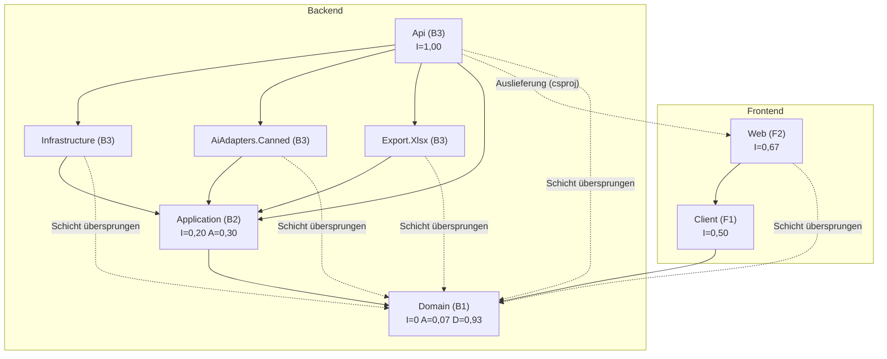

# Architektur-Review CoachFlow

Stand: 13.11.2026 · Grundlage: Quellcode der 8 Produktivprojekte unter `src/` (ohne `bin/`, `obj/`)

**Festgelegte Definitionen**
- **Komponente** = ein .NET-Projekt unter `src/`. Die 8 Testprojekte zählen nicht dazu.
- **Abhängigkeit A → B** = A hat eine `ProjectReference` auf B **oder** Produktivcode in A nutzt einen Namespace von B (`using` bzw. `@using`).
- **Abstraktheit A** = (Interfaces + abstrakte Klassen und Records) ÷ alle Typdeklarationen. Gezählt werden Klassen, Records, Structs und Interfaces, auch verschachtelte Typen; Enums nicht. Razor-Komponenten zählen als Klassen.
- **Instabilität I** = Ce / (Ca + Ce), **Distanz D** = |A + I − 1|.

---

## 1. Architekturbeschreibung

### 1.1 Systemkontext
- **Nutzer:** Volleyball-Trainerinnen und -Trainer im Browser, als PWA, die offline auch nur lesen kann. Rollen gibt es nicht (`CoachFlowUser : IdentityUser<Guid>`).
- **Externe Systeme:**
  - **PostgreSQL** im Betrieb, **SQLite** in der Entwicklung ([InfrastructureSetup.cs](src/CoachFlow.Infrastructure/InfrastructureSetup.cs#L489-L494)).
  - **KI-Anbieter**: als Port vorhanden, aber noch nicht angebunden. Es gibt nur den Testadapter `Canned` ([Program.cs:333-337](src/CoachFlow.Api/Program.cs#L333-L337)).
  - **E-Mail-Dienst**: fehlt noch. Ein Platzhalter schreibt nur ins Log ([LoggingEmailSender.cs](src/CoachFlow.Api/LoggingEmailSender.cs)).
  - **localStorage des Browsers** für die Offline-Kopie ([BrowserStore.cs](src/CoachFlow.Web/BrowserStore.cs)).

### 1.2 Bausteinsicht

**Backend**

| Komponente | Verantwortung |
|---|---|
| `CoachFlow.Domain` | Reine Fachregeln ohne Abhängigkeiten: Prüfungen für Übungen, Pläne und KI-Vorschläge, das Plan-Limit sowie Wertobjekte wie `ExerciseContent` und `TrainingParameters`. Wird auch im Browser ausgeliefert. |
| `CoachFlow.Application` | Anwendungsfälle (`ExerciseService`, `PlanService`, `SuggestionService`), die Entitäten (`Exercise`, `TrainingPlan`, `AiSuggestion`) und die Ports (Repositories, `IUnitOfWork`, `IExerciseSuggestionProvider`, `IPlanExporter`, `IAiBudgetLedger`). Dazu kommen Budget-Guard und Rate-Limit-Gate für die KI. |
| `CoachFlow.Infrastructure` | EF-Core-Adapter: DbContext mit Identity, Repositories, Unit of Work, Budget-Ledger mit atomarer Reservierung, Migrationen und DI-Registrierung der Services. |
| `CoachFlow.AiAdapters.Canned` | Testadapter für den KI-Port mit festen Antworten, Fehler- und Hänge-Varianten. |
| `CoachFlow.Export.Xlsx` | Adapter für `IPlanExporter`, schreibt mit ClosedXML ein druckfertiges xlsx-Blatt. |
| `CoachFlow.Api` | Host und Composition Root: Minimal-API-Endpunkte, Identity mit Cookie, Rate-Limiter, Auslieferung der Blazor-App vom selben Ursprung, Health-Check. |

**Frontend**

| Komponente | Verantwortung |
|---|---|
| `CoachFlow.Client` | UI-freie Browserlogik: typisierter API-Client (`CoachFlowApi`), Sitzungs- und Offline-Zustand (`AppState`), Offline-Cache (`PlanCache`, `PlanLibrary`, `FocusAreaCatalog`), Zeitgrenzen der KI-Anfrage (`SuggestionRequester`, 5 s / 15 s) und Formularmodelle. |
| `CoachFlow.Web` | Blazor-WebAssembly-PWA: 5 Seiten, 5 Komponenten, 2 Layouts, Service Worker und der `localStorage`-Adapter. |

### 1.3 Schichtenmodell

| Schicht | Komponenten |
|---|---|
| B3 Adapter (treibend und getrieben) | `Api` (treibend und Composition Root), `Infrastructure`, `AiAdapters.Canned`, `Export.Xlsx` |
| B2 Anwendung | `Application` |
| B1 Domäne (Shared Kernel) | `Domain` |
| F2 UI | `Web` |
| F1 Client-Logik | `Client` (stützt sich auf B1) |

### 1.4 Erkannte Architekturstile und Muster
- **Hexagonal (Ports & Adapters) bzw. Onion.** Die Ports liegen in Application ([IExerciseSuggestionProvider.cs](src/CoachFlow.Application/Ai/IExerciseSuggestionProvider.cs), [IPlanExporter.cs](src/CoachFlow.Application/Plans/IPlanExporter.cs)), alle Abhängigkeiten zeigen nach innen. Ein Architekturtest erzwingt das ([DependencyRuleTests.cs](tests/CoachFlow.Architecture.Tests/DependencyRuleTests.cs)).
- **Modularer Monolith.** Ein Deployment; die API liefert die SPA mit aus.
- **Repository und Unit of Work** mit optimistischer Sperre über `Version` als Concurrency-Token.
- **Ergebnistypen als Sum Types** (`ChangeOutcome<T>`, `RequestOutcome`, `AdoptOutcome`) statt Exceptions.
- **Shared Kernel.** Dieselben Domänenregeln laufen im Browser und auf dem Server.
- **Im Frontend: Komponenten plus Service-Schicht** (MVVM-artig mit Formularmodellen). Kein MVC.
- **Composition Root** in `Api/Program.cs`, gesteuert über Konfiguration (`Ai:Provider`, `Database:Provider`).

### 1.5 Kommunikation zwischen Frontend und Backend
- REST/JSON über HTTP, alles auf demselben Ursprung.
- Cookie-Authentifizierung mit `SameSite=Strict`, also ohne CORS.
- Synchron, keine Events, kein Push.
- Fehler kommen als `ApiError {code, message, errors}` zurück.
- Die KI-Anfrage ist ein synchroner `POST` mit 13 s Frist auf dem Server und 15 s im Client.

---

## 2. Metrik-Tabelle (gemessen)

| Komponente | Schicht | Fan-in Ca | Fan-out Ce | I | A | D | Zyklen | Belege |
|---|---|---|---|---|---|---|---|---|
| Domain | B1 | 7 | 0 | 0,00 | 1/15 = 0,07 | **0,93** | – | Ca: Application, Infrastructure, Canned, Export, Api, Client, Web (`using CoachFlow.Domain`). Abstrakt nur `PlanLimitDecision`. |
| Application | B2 | 4 | 1 | 0,20 | 13/43 = 0,30 | 0,50 | – | Ce: Domain. Ca: Infrastructure, Canned, Export, Api. 8 Interfaces und 5 abstrakte Records. |
| Infrastructure | B3 | 1 | 2 | 0,67 | 0/16 = 0 | 0,33 | Namespace-Zyklus (s. u.) | Ce: Application, Domain. Ca: Api. 16 Typen inkl. Migrationen, `Initial` einmal gezählt. |
| AiAdapters.Canned | B3 | 1 | 2 | 0,67 | 0/1 | 0,33 | – | [CannedSuggestionProvider.cs](src/CoachFlow.AiAdapters.Canned/CannedSuggestionProvider.cs#L1-L2) |
| Export.Xlsx | B3 | 1 | 2 | 0,67 | 0/1 | 0,33 | – | [XlsxPlanExporter.cs](src/CoachFlow.Export.Xlsx/XlsxPlanExporter.cs#L1-L4) |
| Api | B3 | 0 | 6 | 1,00 | 0/13 | 0,00 | – | Ce: Infrastructure, Canned, Export, Web (csproj), Application, Domain ([Program.cs](src/CoachFlow.Api/Program.cs#L1-L8), [Endpoints.cs](src/CoachFlow.Api/Endpoints.cs#L1-L8)) |
| Client | F1 | 1 | 1 | 0,50 | 3/39 = 0,08 | 0,42 | Klassen-Zyklus (s. u.) | Ce: Domain. Ca: Web. Abstrakt: `IClientStore`, `PlanListResult`, `SuggestionAttempt`. |
| Web | F2 | 1 | 2 | 0,67 | 0/14 | 0,33 | – | Ce: Client, Domain ([_Imports.razor](src/CoachFlow.Web/_Imports.razor)). Ca: Api (nur csproj, zur Auslieferung). |

### 2.1 Zyklische Abhängigkeiten
- **Auf Komponentenebene: 0.** MSBuild lässt keine zyklischen Projektreferenzen zu, und die Namespace-Nutzung ist ebenfalls zyklenfrei.
- **Unterhalb der Komponentenebene (Zusatzinformation):**
  1. `CoachFlow.Infrastructure` ↔ `CoachFlow.Infrastructure.Budget`: [CoachFlowDbContext.cs:7](src/CoachFlow.Infrastructure/CoachFlowDbContext.cs#L7) nutzt `BudgetMonth`, und `EfAiBudgetLedger` nutzt `CoachFlowDbContext`.
  2. `ApiResult<T>` ↔ `CoachFlowApi` in Client: [ApiResult.cs:27](src/CoachFlow.Client/ApiResult.cs#L27) nutzt `CoachFlowApi.Json`, und `CoachFlowApi` gibt `ApiResult<T>` zurück.

### 2.2 Schichtverletzungen
Strenge Definition: Aufrufe nach oben oder über eine Schicht hinweg.

- **Nach oben: 0.**
- **Über Schichten hinweg: 5.**
  - Infrastructure → Domain
  - Canned → Domain
  - Export → Domain
  - Api → Domain, über DTO-Records mit `ExerciseContent`, `TrainingParameters` und `Finding`
  - Web → Domain, in 7 Razor-Dateien, z. B. `PlanLimitPolicy` und `SuggestionValidator`
- **Nicht gezählt:**
  - Api → Infrastructure, Canned und Export: Abhängigkeiten innerhalb derselben Schicht (Verdrahtung im Composition Root).
  - Api → Web: eine reine Build- und Auslieferungsabhängigkeit; Api nutzt keinen `CoachFlow.Web`-Namespace.

### 2.3 Öffentliche Schnittstellen und Endpunkte

| Komponente | Öffentliche Typen | Endpunkte / Routen |
|---|---|---|
| Api | 10 | 16 fachliche HTTP-Endpunkte in [Endpoints.cs](src/CoachFlow.Api/Endpoints.cs): focus-areas 2, exercises 4, plans 6, suggestions 4. Dazu `POST /api/auth/logout`, `GET /health` und 2 Fallbacks. |
| Application | 48 (inkl. 5 Enums) | – |
| Client | 39 | – |
| Domain | 19 | – |
| Infrastructure | 14 (ohne Migrationen) | – |
| AiAdapters.Canned | 1 | – |
| Export.Xlsx | 1 | – |
| Web | 1 (+13 Razor-Komponenten) | 6 `@page`-Routen in 5 Seiten |

Die Zahl der Identity-Endpunkte aus `MapIdentityApi` ist **nicht ermittelbar**: Das Framework erzeugt sie, im Quellcode stehen sie nicht. Der Client nutzt davon 3: register, login und manage/info.

### 2.4 Geteilte Datenbanktabellen
Es gibt 10 Tabellen: Exercises, FocusAreas, Plans, Suggestions, BudgetMonths, BudgetReservations und AspNetUsers, -UserClaims, -UserLogins, -UserTokens ([Migration](src/CoachFlow.Infrastructure/Migrations/20261108155154_Initial.cs)).

- **Ein** DbContext, nur `Infrastructure` greift auf Tabellen zu.
- Die vier `AspNetUser*`-Tabellen nutzt zusätzlich das Identity-Framework, das in `Api` konfiguriert wird ([Program.cs:253](src/CoachFlow.Api/Program.cs#L253)).
- Innerhalb von Application schreiben zwei Anwendungsfälle in `Exercises`: `ExerciseService` und `SuggestionService.AdoptAsync`.
- Fremdschlüssel gibt es **nur** innerhalb der Identity-Tabellen. `Plans.OwnerId`, `Suggestions.UserId` und `Exercises.CreatedBy` haben keinen Fremdschlüssel.

---

## 3. Kennzahlen des Gesamtsystems

| Kennzahl | Wert |
|---|---|
| Komponenten | 8: Backend 6 (inkl. Domain, die auch im Browser läuft), Frontend 2 |
| Abhängigkeitskanten | 16 |
| Schichten | Backend 3, Frontend 2 (+ geteilte Domäne) |
| Schichtverletzungen | 0 nach oben, 5 über Schichten hinweg (alle zur Domäne) |
| Zyklen | 0 auf Komponentenebene, 1 auf Namespace-Ebene, 1 auf Klassenebene |
| Ø Distanz D | 0,40 |
| Max. D | 0,93 (Domain) |
| Fachliche HTTP-Endpunkte | 16 (+2 eigene technische) |
| Tabellen | 10, davon 0 zwischen Komponenten geteilt außer Identity (4) |
| Architekturtests | 5 Regeln ([DependencyRuleTests.cs](tests/CoachFlow.Architecture.Tests/DependencyRuleTests.cs)) |

---

## 4. Bewertung und Empfehlungen (Interpretation)

### 4.1 Gesamteindruck
Für einen MVP ist die Architektur ungewöhnlich sauber:
- Die Abhängigkeiten zeigen streng nach innen.
- Die KI liegt hinter einem anbieterneutralen Port, und ihre Grenzen (Frist, Budget, Rate Limit) setzt die Anwendungsschicht durch.
- Architekturtests sichern die Regeln ab.

Die 5 „Verletzungen“ entstehen nur durch die strenge Definition. Im Onion-Stil ist es gewollt, dass äußere Schichten direkt auf die Domäne zugreifen, daher bewerte ich sie nicht als Mangel.

### 4.2 Auffällige Komponenten
- **Domain liegt in der Zone of Pain** (I = 0, A = 0,07, D = 0,93). Für eine Regelbibliothek ist das normalerweise harmlos. Hier aber werden die Domänen-Records **unverändert an drei Stellen serialisiert**: in JSON-Spalten der Datenbank (`AsJson()` in [CoachFlowDbContext.cs:446](src/CoachFlow.Infrastructure/CoachFlowDbContext.cs#L446)), im HTTP-Vertrag und im `localStorage`. Eine Umbenennung in `ExerciseContent` würde dadurch zur Datenmigration. Die Zone of Pain ist hier also echt.
- **Hubs mit hohem Fan-in und hohem Fan-out: keine.** Api hat Ce = 6 und Ca = 0, ist also ein reiner Composition Root. Domain ist eine reine Senke.
- **Zyklen:** nur die zwei kleinen Zyklen innerhalb von Komponenten (Abschnitt 2.1), mit geringer Auswirkung.

### 4.3 Die 5 größten Architekturrisiken

| # | Risiko | Qualitätsziel | Beleg |
|---|---|---|---|
| R1 | **Persistenz-, API- und Cache-Format hängen alle an den Domänen-Records.** JSON-Spalten haben keine Schemaversion, und eine Feldumbenennung bricht gespeicherte Pläne lautlos. | Änderbarkeit, Zuverlässigkeit | `AsJson()` auf `Content`, `Items`, `Parameters` und `Draft`; `PlanCache.Key = "...v1"` ist die einzige Versionierung. |
| R2 | **Der API-Vertrag liegt doppelt vor.** Endpunkte geben Application-Entitäten direkt zurück (`Results.Ok(plan)`), und der Client bildet sie als handgeschriebene DTOs nach (`ApiError`, `PlanLimitWarning`, `PlanInput` doppelt). Die Konsistenz sichern nur Tests ab. | Änderbarkeit | [Endpoints.cs:68](src/CoachFlow.Api/Endpoints.cs#L68), [Models.cs](src/CoachFlow.Client/Models.cs), [ClientContractTests.cs](tests/CoachFlow.Api.Tests/ClientContractTests.cs) |
| R3 | **Datenintegrität:** Nutzer-Ids ohne Fremdschlüssel, und eine Race Condition beim Plan-Limit. Zwei parallele `CreateAsync` sehen beide 9 Pläne, danach existieren 11. | Zuverlässigkeit | Migration (FK nur bei Identity); [PlanService.cs:756-772](src/CoachFlow.Application/Plans/PlanService.cs#L756-L772) ohne Sperre oder Constraint |
| R4 | **Der Betrieb ist auf eine Instanz festgelegt.** `AiRequestGate` hält den Zustand im Speicher, die Migration läuft beim Start. Ein zweites Replikat hebelt das Rate Limit aus und migriert konkurrierend. | Betreibbarkeit, Last, Verfügbarkeit | [AiRequestGate.cs](src/CoachFlow.Application/Ai/AiRequestGate.cs), [Program.cs:281-285](src/CoachFlow.Api/Program.cs#L281-L285) |
| R5 | **Der Testadapter steckt im Produktions-Build.** `Ai:Provider=None` wird auf `CannedSuggestionProvider` abgebildet und nur durch Budget 0 gesperrt. Eine falsche Konfiguration (`Canned`) liefert im Betrieb Scheinvorschläge. Dazu fehlen E-Mail-Versand und Passwort-Reset. | Betreibbarkeit, Sicherheit | [Program.cs:333-337](src/CoachFlow.Api/Program.cs#L333-L337), [Program.cs:251](src/CoachFlow.Api/Program.cs#L251) |

### 4.4 Verbesserungsvorschläge (priorisiert)
1. **Persistenzformat von der Domäne entkoppeln (zu R1).** Eigene Persistenz-DTOs für die JSON-Spalten, versioniert mit `schemaVersion`, oder als Alternative EF-`OwnsOne/ToJson` mit expliziter Abbildung. Dazu ein Roundtrip-Test mit eingefrorenen JSON-Beispielen aus dem heutigen Stand.
2. **Ein gemeinsames Vertragsprojekt `CoachFlow.Contracts` einführen (zu R2).** Es enthält Request/Response-DTOs und `ApiError`; Api und Client referenzieren es. Die Endpunkte bilden Entitäten explizit auf DTOs ab. Damit entfällt die doppelte Pflege, und der Architekturtest „Client teilt nur Domain“ wird auf „Domain + Contracts“ erweitert.
3. **Integrität absichern (zu R3).**
   - Fremdschlüssel von `OwnerId`, `UserId` und `CreatedBy` auf `AspNetUsers` mit einer bewussten Löschstrategie.
   - Plan-Limit serialisieren, z. B. über eine Transaktion mit `SELECT … FOR UPDATE` auf die Nutzerzeile oder einen Zähler mit Concurrency-Token.
4. **Produktions-Composition bereinigen (zu R5).** Einen eigenen `DisabledSuggestionProvider` für `None` anlegen. `Canned` in Release-Builds nicht registrieren, z. B. über eine Bedingung oder ein Test-Hosting über `ApiFactory`.
5. **Annahme A8 explizit machen (zu R4).** Einen Startup-Check oder eine Doku-Fitness-Function ergänzen. Vor dem Skalieren den Gate-Zustand in die Datenbank oder in Redis verlagern und die Migration als eigenen Deploy-Schritt ausführen.
6. **Kleinere Punkte:**
   - `CoachFlowApi.Json` in eine eigene `JsonDefaults`-Klasse verschieben, damit der Klassen-Zyklus verschwindet.
   - `BudgetMonth` und `BudgetReservation` samt Konfiguration in eine `IEntityTypeConfiguration` im Budget-Namespace verschieben, damit der Namespace-Zyklus verschwindet.
   - Architekturtests ergänzen: Web darf nicht auf Application zugreifen, Adapter nicht aufeinander.

---

## 5. Abhängigkeitsdiagramm

