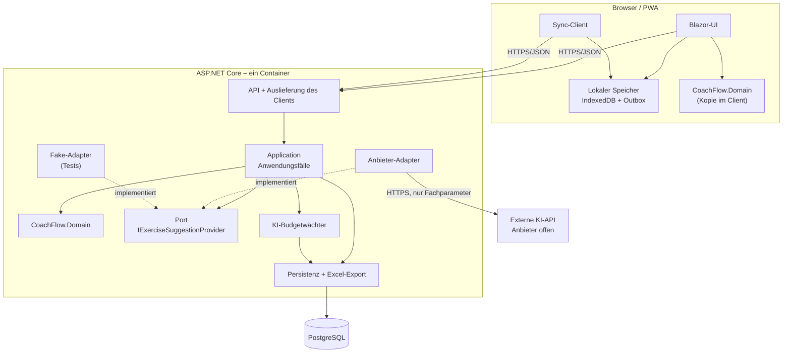

# CoachFlow: Architekturentwurf für den MVP

**Status:** Dies ist ein Entwurf. Nichts wurde gebaut, gemessen oder getestet. Alle Wirkungen sind **erwartet**, nicht nachgewiesen.

Nur eine Aussage stammt aus einer Recherche: das Support-Ende von .NET 9. Paketstände und Kompatibilität habe ich nicht geprüft.

**Vorab zu entscheiden:**
- **.NET 9:** Der Support endet am 10.11.2026, also in sechs Tagen.
- **Zeitlimit:** Die Vorgaben 5 s und 15 s widersprechen sich.
- **Offline-Umfang:** „Offline: Ja“ ist nicht näher bestimmt.
- **Nutzerbezug:** Es ist offen, wem Pläne gehören und wofür das Limit von 10 gilt.
- **Budget:** Es ist kein Betrag genannt.

## 1. Vorgaben, offene Punkte und Annahmen

### Verbindliche Vorgaben (V)

| Nr. | Vorgabe |
|---|---|
| V1 | Webanwendung, Backend C#/.NET 9, MVP ohne Altsystem, zunächst Volleyball |
| V2 | Eingaben: Teilnehmerzahl, Erfahrungsniveau (6 Stufen), Streuung 1–3, Dauer, höchstens 2 Schwerpunkte |
| V3 | Schwerpunkte K0, K1, K2, Abwehr, Mannschaftstaktik, Einzeltaktik, durch Nutzer erweiterbar |
| V4 | Eigene Übungen und Pläne anlegen, bearbeiten und speichern; bis zu 10 Pläne abrufbar; xls-Export |
| V5 | KI ist optional. Vorschläge werden vor der Übernahme angezeigt und sind bearbeitbar. Planung funktioniert ohne KI |
| V6 | Offline-Nutzung: Ja |
| V7 | Bei KI-Ausfall oder Verzögerung gibt es eine Meldung an den Nutzer |
| V8 | Keine Budgetüberschreitung, Meldung an den Nutzer |
| V9 | Nicht im Umfang: Berechtigungen, Trennung der Übungsbestände, Bezahlfunktion |
| V10 | Mengengerüst: 250 Personen, 50 gleichzeitig |

Präferenzen gibt es keine. Frontend und Datenhaltung sind offen, Hosting und KI-Anbieter unbekannt.

### Widersprüche und Spannungen (W)

| Nr. | Befund | Auswirkung | Umgang im Entwurf |
|---|---|---|---|
| W1 | .NET 9 ist verbindlich, der Support endet aber am 10.11.2026. Danach gibt es keine Sicherheitsupdates mehr; .NET 10 ist LTS bis November 2028 | Konflikt mit dem Dauerbetrieb, trifft die Betreibbarkeit | Entwurf bleibt versionsneutral und nutzt .NET 9 wie vorgegeben. **Empfehlung: Vorgabe auf .NET 10 ändern** |
| W2 | Generierung endet „spätestens nach 15 Sekunden“, die akzeptable Wartezeit ist aber 5 s | Bei einem harten Limit von 5 s könnten viele Antworten scheitern (unbelegt) | Annahme A1: 5 s ist die Hinweisschwelle, 15 s die harte Grenze. Beide Werte sind konfigurierbar |
| W3 | 250 Registrierte, aber keine Trennung der Übungsbestände | Es entsteht ein gemeinsamer Bestand, in dem jeder alles ändern kann | Annahme A2 |
| W4 | Das Limit von 10 Plänen nennt keinen Bezugspunkt | Ohne Nutzerbezug wäre es global, also bei 250 Personen unbrauchbar | Annahme A3 |
| W5 | Offline widerspricht in Teilen Limit, Budget und KI | Limit und Budget können offline nicht zentral durchgesetzt werden | Annahme A4 |
| W6 | Budget soll einsehbar sein, Rollen sind aber nicht im Umfang | Eine Admin-Oberfläche bräuchte eine Rolle | Betreiberbericht außerhalb der App (siehe AE-7) |

### Fehlende Angaben (O)

| Nr. | Fehlt | Auswirkung |
|---|---|---|
| O1 | Budgetbetrag und ob er nur KI oder auch Hosting umfasst | Budget-Prüfung bleibt ohne Sollwert |
| O2 | RPO/RTO, Aufbewahrungsdauer | Sicherungskonzept beruht auf Annahme A9 |
| O3 | Datenschutz: Ort der Daten, Regeln des KI-Anbieters | Kann Anbieter und Hosting ausschließen |
| O4 | Unterschied zwischen „Anpassung“ (Stufe 2) und „Variante“ (Stufe 3) | Bestimmt die Validierungsregeln |
| O5 | Bedeutung von K0–K2 | Annahme: Aufschlag, Annahme/Side-out, Block-/Abwehrsituation. Im Entwurf nur Stammdaten |
| O6 | „12,U13,U14“ ist vermutlich U12 | Nur Beschriftung, leicht änderbar |
| O7 | „xls“ wörtlich oder xlsx gemeint | Bestimmt die Bibliothek |
| O8 | Endgeräte, Browser, Kenntnisse der Entwicklerin | Beeinflusst vor allem die Frontendwahl |
| O9 | Definition von „gleichzeitig“ (angemeldet oder aktive Anfragen) | Bestimmt die Lastprüfung |
| O10 | Zulässige Grenzen für Dauer und Teilnehmerzahl | 5–14 ist nur der typische Bereich und daher keine harte Regel |

### Eigene Annahmen (A)

| Nr. | Annahme | Falls sie nicht stimmt |
|---|---|---|
| A1 | Ab 5 s Hinweis und Abbruchmöglichkeit, bei 15 s harter Abbruch | Konfiguration ändern; KI-Erfolgsquote neu prüfen |
| A2 | Eine Anmeldung ohne Rollen. Übungen und eigene Schwerpunkte liegen in einem gemeinsamen Bestand | Bei getrennten Beständen zusätzlich `OwnerId` und Abfragefilter |
| A3 | Die 10 Pläne gelten je Nutzer, Entwürfe zählen mit. Beim elften wird gesperrt, nie automatisch gelöscht | Regel liegt zentral und ist einfach änderbar |
| A4 | Offline heißt: Übungen und Pläne lesen und bearbeiten, lokal speichern, später synchronisieren. Online bleiben erstes Login, KI und Export | Offline-Export oder Vollbetrieb ohne Erst-Login vergrößern den Client |
| A5 | Pläne enthalten keine Spielernamen, nur Anzahlen | Bei Namen, gerade Minderjähriger, verschärfen sich die Datenschutzanforderungen deutlich |
| A6 | Plan: 0–2 Schwerpunkte; KI-Anfrage: 1–2 | Eine einzelne Regel anpassen |
| A7 | Ein geeigneter Anbieter liefert strukturierte Ausgabe und Verbrauchsdaten | Ohne Verbrauchsdaten ist die Budgetkontrolle nur als Schätzung möglich |
| A8 | Eine Instanz genügt für die Last | Lasttest prüft das |
| A9 | Tägliche Sicherung, 14 Tage Aufbewahrung, RPO 24 h, RTO 4 h | Durch echte Werte ersetzen |

## 2. Empfohlene Architektur

**Empfehlung:** ein modularer Monolith nach dem Ports-and-Adapters-Prinzip, mit einer installierbaren Offline-Webanwendung (PWA) als Client und einer Domänenbibliothek, die Client und Server gemeinsam nutzen.

**Pfeilbedeutung:**
- **Durchgezogen:** A ruft B auf oder hängt zur Laufzeit von B ab.
- **Gestrichelt:** A implementiert die Schnittstelle B; die Abhängigkeit zeigt also vom Adapter zur Anwendung.
- **Wichtig:** Kein Pfeil führt von Domain oder Application zu einem konkreten Anbieter.

### Komponenten

| Komponente | Zuständigkeit | Darf abhängen von |
|---|---|---|
| Domain | Teilnehmerprüfung, Dauerberechnung, Streuungsregeln, Vorschlagsvalidierung; ohne I/O | nichts |
| Application | Anwendungsfälle, Ports, Limit von 10 Plänen, Ablauf der Übernahme | Domain |
| Anbieter-Adapter | Prompt, Modell, Antwortformat, Fehlerübersetzung, Verbrauchsdaten | Application-Port, Anbieter-API |
| Budgetwächter | Reservierung und Abrechnung je KI-Aufruf, Nutzerkontingent | Persistenz |
| Infrastructure | EF Core, Excel-Export | Application |
| API | Authentifizierung, HTTP, Ratenbegrenzung, Auslieferung des Clients | Application |
| Client | Bedienung, lokaler Speicher, Outbox, Synchronisation | Domain, API |

### Architekturentscheidungen

**AE-1: KI nur hinter einem fachlichen Port**
- **Ziel:** Änderbarkeit (hoch).
- **Mechanismus:** Der Port kennt nur eigene Typen: `SuggestionRequest`, `SuggestionDraft`, `SuggestionFailure`. Anbieterwissen liegt ausschließlich im Adapter. Eine gemeinsame Vertragstest-Suite läuft gegen jeden Adapter.
- **Nachteile:** Zusätzliche Abstraktion bei nur einem echten Anbieter; Besonderheiten eines Anbieters bleiben ungenutzt.
- **Annahme:** Anbieter mit vergleichbaren Fähigkeiten (A7).
- **Prüfung:** Einen zweiten Adapter als Probe bauen. Domain und Application dürfen sich dabei nicht ändern, Architekturtests erzwingen die Abhängigkeitsregeln. Betroffene Teile werden dokumentiert: Adapter, Konfiguration, Preistabelle, Vertragstest-Fixtures.

**AE-2: Kernfunktionen ohne Laufzeitabhängigkeit von der KI**
- **Ziel:** Verfügbarkeit (hoch).
- **Mechanismus:** Kein Plan- oder Übungsablauf ruft die KI auf. Die Funktion ist abschaltbar (`Ai:Provider=None`). Ein Circuit Breaker beendet Aufrufe nach Fehlerserien sofort, und die Aufrufe sind auf wenige gleichzeitige begrenzt.
- **Nachteile:** Kein automatischer Wiederholungsversuch; einzelne vorübergehende Fehler erreichen den Nutzer.
- **Annahme:** Wiederholungen lohnen sich innerhalb von 15 s und bei hartem Budget nicht.
- **Prüfung:** Fake-Adapter simuliert Timeout, HTTP 429 und 500. Der E2E-Test zeigt, dass Auswählen, Bearbeiten und Speichern weiterhin gehen und der begonnene Plan erhalten bleibt.

**AE-3: Gestaffelte Zeitgrenzen**
- **Ziel:** Verfügbarkeit (hoch).
- **Mechanismus:** Bei 5 s zeigt der Client einen Hinweis und „Abbrechen“. Der Server bricht bei rund 13 s ab und der Client hart bei 15 s. So kommt die Fehlermeldung auch dann rechtzeitig, wenn die Antwort des Servers ausbleibt.
- **Nachteile:** Langsame, aber brauchbare Antworten gehen verloren; abgebrochene Aufrufe können trotzdem Kosten verursachen.
- **Annahme:** Lösung von W2 nach A1.
- **Prüfung:** Test mit Fake-Adapter ohne Antwort und mit `TimeProvider`; zusätzlich Latenzmessung beim gewählten Anbieter.

**AE-4: Vorschläge als eigener Zustand mit Validierung vor der Übernahme**
- **Ziel:** Zuverlässigkeit (hoch).
- **Mechanismus:** KI-Ergebnisse werden als `AiSuggestion` gespeichert, nie direkt als `Exercise`. Eine Übung entsteht nur über den Anwendungsfall „Übernehmen“, und dabei prüft der Server die zuletzt bearbeitete Fassung erneut. Blockierende Befunde verhindern die Übernahme.
- **Nachteile:** Zusatzzustand, zusätzliche Oberfläche, gelegentlich Korrekturaufwand.
- **Grenze:** Die Prüfung erkennt nur maschinell prüfbare Mängel. Fachliche Qualität oder Sicherheit einer Übung bleibt Urteil der Trainerin.
- **Annahme:** Regeln sind aus strukturierten Feldern ableitbar.
- **Prüfung:** Tabellengetriebene Tests, darunter fehlende Pflichtfelder und 12 benötigte bei 6 Personen. Ein Test belegt außerdem, dass keine Übung ohne Übernahme entsteht.

**AE-5: Gemeinsame Domänenbibliothek**
- **Ziel:** Testbarkeit (mittel), Zuverlässigkeit offline.
- **Mechanismus:** Dieselben reinen C#-Regeln laufen im Client und auf dem Server. Der Server bleibt maßgeblich.
- **Nachteile:** Bindung an Blazor; Client-Updates nötig, wenn sich Regeln ändern.
- **Annahme:** Offline-Prüfungen werden wirklich gebraucht.
- **Prüfung:** Unit-Tests ohne Netz und Datenbank, zweimal ausgeführt mit identischem Ergebnis.

**AE-6: Lokal zuerst speichern, mit Outbox synchronisieren**
- **Ziel:** Vorgabe V6, Verfügbarkeit.
- **Mechanismus:** Jede Änderung geht zuerst in IndexedDB und dann in die Outbox. IDs erzeugt der Client, die Synchronisation ist idempotent. Versionsnummern erkennen Konflikte. Bei einem Konflikt wird nichts überschrieben: Die lokale Fassung bleibt als Konfliktkopie erhalten und wird angezeigt.
- **Nachteile:** Größter Komplexitätstreiber des MVP; Konflikte im gemeinsamen Bestand und Grenzfälle beim Limit (ein elfter Plan bleibt lokal und erhält eine Meldung).
- **Annahme:** Konflikte sind selten (A4).
- **Prüfung:** Playwright mit getrenntem Netz, Tests für Mehrfachzustellung und parallele Bearbeitung. Browser können lokale Daten unter Umständen löschen, das muss je Zielgerät geprüft werden.

**AE-7: Budgetwächter mit Reservierung vor dem Aufruf**
- **Ziel:** Betreibbarkeit (mittel), Vorgabe V8.
- **Mechanismus:** Vor jedem Aufruf werden die maximal möglichen Kosten aus Eingabegrenze, `max_tokens` und Preistabelle reserviert. Die Abrechnung folgt den gemeldeten Verbrauchsdaten. Passt die Reservierung nicht mehr ins Monatsbudget, findet kein Aufruf statt und der Nutzer erhält eine Meldung. Ohne Verbrauchsdaten bleibt die Reservierung bestehen. Dazu kommen ein Tageskontingent je Nutzer und ein Monatsbericht für die Betreiberin als SQL-Skript oder Log, also ohne Admin-Rolle.
- **Nachteile:** Das Budget wird konservativ ausgeschöpft; Preise müssen gepflegt werden. Kurz vor Monatsende kann die KI gesperrt sein, obwohl noch Budget übrig ist.
- **Annahme:** Ein Budgetbetrag liegt vor (O1). Fixe Hostingkosten werden durch die Tarifwahl begrenzt, nicht durch die App.
- **Prüfung:** Parallelitätstest: Bei N gleichzeitigen Anfragen überschreitet die Summe der Reservierungen das Budget nie. Monatlicher Abgleich mit der Anbieterrechnung, zusätzlich ein Limit beim Anbieter, falls verfügbar.

**AE-8: Ein Deployment-Artefakt**
- **Ziel:** Betreibbarkeit (mittel).
- **Mechanismus:** Ein Container liefert API und Client aus, die Datenbank läuft als verwalteter Dienst. Dadurch bleibt die Lösung portabel, obwohl das Hosting unbekannt ist. Konfiguration läuft über Umgebungsvariablen. Dazu gehören ein Health-Endpunkt, strukturierte Logs und ein Runbook.
- **Nachteile:** Keine unabhängige Skalierung; bei Updates oder Neustarts ist kurz keine Sicherheit durch Redundanz vorhanden.
- **Annahme:** A8. Der Offline-Client überbrückt kurze Serverausfälle teilweise.
- **Prüfung:** Einmal von der Dokumentation aus auf eine leere Umgebung deployen und eine Wiederherstellung ausführen, mit Zeitmessung.

## 3. Datenmodell in Grundzügen

| Entität | Wichtige Felder | Beziehungen |
|---|---|---|
| `User` | Id, E-Mail, Anmeldedaten | 1:n `TrainingPlan` |
| `Exercise` | Id, Titel, Beschreibung, Dauer, MinPersonen, MaxPersonen (optional), Herkunft (eigen/KI), Version, ArchiviertAm | n:m `FocusArea`, n:m Niveaus, 1:n `ExerciseVariant` |
| `ExerciseVariant` | Titel, Beschreibung, Art (Anpassung/Variante) | gehört zu `Exercise` |
| `FocusArea` | Id, Name, IstSystemwert | n:m zu Übungen und Plänen |
| `TrainingPlan` | Id, OwnerId, Titel, Teilnehmerzahl, Niveau, Streuung (1–3), Dauer, Status, Version | 1:n `PlanItem`, höchstens 2 `FocusArea` |
| `PlanItem` | Position, geplante Dauer, Notiz, Snapshot der Übung, `SourceExerciseId` (optional) | gehört zu `TrainingPlan` |
| `AiSuggestion` | Status, Entwurf, Prüfbefunde, Anfrageparameter, Anbieter, Modell, Prompt-Version | gehört zu `User`, führt optional zu `Exercise` |
| `AiUsageEntry` | Anfrage-ID, reservierte und tatsächliche Kosten, Ergebnis, Monat | Basis für Budget und Bericht |

**Festlegungen:**
- **Snapshot:** `PlanItem` kopiert die Übungsdaten. Im gemeinsamen Bestand kann sonst die Änderung einer anderen Person einen gespeicherten Plan verändern. Der Preis ist Redundanz.
- **Archivieren statt Löschen:** Übungen verschwinden aus der Auswahl, Pläne bleiben unverändert.
- **Entwürfe:** Sie sind immer speicherbar, auch mit Warnungen, damit kein begonnener Plan verloren geht. Die strengen Regeln gelten für den Status `Vollständig`.
- **Niveau:** Es ist ein Stammdatenwert, damit später weitere Sportarten möglich sind. Mehr wird dafür nicht vorbereitet.

## 4. Zwei Abläufe

### Ablauf A: Planung mit vorhandenen Übungen (auch offline)

1. Die Trainerin gibt Teilnehmerzahl, Niveau, Streuung, Dauer und bis zu zwei Schwerpunkte ein.
2. Der Client filtert Übungen aus dem lokalen Speicher.
3. Sie wählt Übungen aus; die Snapshots landen im Plan.
4. Die Domain prüft sofort Personenzahl, Gesamtdauer und nach Streuung erforderliche Anpassungen oder Varianten. Befunde erscheinen als Hinweise.
5. Jede Änderung wird lokal gespeichert und in die Outbox gelegt.
6. Sobald eine Verbindung besteht, überträgt der Sync-Client die Änderungen. Der Server prüft Version und Limit von 10 Plänen.
7. Bei Limitüberschreitung oder Konflikt bleibt die lokale Fassung erhalten und der Nutzer sieht eine Meldung.
8. Der Export erfolgt online über den Server.

### Ablauf B: KI-Vorschlag anfordern und übernehmen

1. Die Trainerin fordert einen Vorschlag an. Offline ist die Funktion deaktiviert und nennt den Grund; das Planen geht weiter.
2. Der offene Plan bleibt lokal gespeichert.
3. Der Server prüft Anmeldung, Nutzerkontingent, Parallelitätsgrenze, Circuit Breaker und Budgetreservierung. Scheitert eine Prüfung, kommt sofort eine Meldung, ohne KI-Aufruf.
4. Der Adapter sendet nur Fachparameter, keine personenbezogenen Daten.
5. Nach 5 s erscheinen Hinweis und „Abbrechen“. Ein Abbruch wird bis zum Anbieteraufruf weitergereicht.
6. Der Adapter übersetzt die Antwort in `SuggestionDraft` oder `SuggestionFailure`. Die Ausgabe gilt als nicht vertrauenswürdig und wird nur als Text dargestellt.
7. Der Budgetwächter rechnet ab.
8. Der Server speichert `AiSuggestion` mit den Prüfbefunden.
9. Die Trainerin sieht Vorschlag und Befunde, zum Beispiel „benötigt 12 Personen, verfügbar sind 6“.
10. Sie bearbeitet oder verwirft den Vorschlag.
11. Bei „Übernehmen“ validiert der Server die aktuelle Fassung erneut.
12. Ohne Blocker entsteht eine `Exercise` mit Herkunft „KI“, die optional dem Plan hinzugefügt wird. Sonst bleibt der Vorschlag bearbeitbar.
13. **Fehlerfall:** Bei Timeout, Anbieterfehler oder ungültiger Antwort sieht die Trainerin spätestens nach 15 s eine verständliche Meldung, der Plan bleibt unverändert.

## 5. Technologieentscheidungen

Alle Punkte sind Empfehlungen; nur .NET 9 ist eine Vorgabe.

| Bereich | Empfehlung | Ziel und Mechanismus | Nachteil | Annahme | Prüfung |
|---|---|---|---|---|---|
| Backend | ASP.NET Core mit .NET 9 (V1), EF Core | Standardstack, wenig Fremdteile | W1 | Wechsel auf .NET 10 bleibt klein | Upgrade-Probelauf |
| Frontend | Blazor WebAssembly als PWA | Teilt Domain mit Server (AE-5) | Größerer Erstdownload, JS-Interop für IndexedDB | Kenntnisse in C# (O8) | Prototyp auf Zielgeräten |
| Datenbank | PostgreSQL, möglichst verwaltet | Sicherung ausgelagert, Betriebsaufwand sinkt, Migrationen über EF | Fixkosten | Dienst passt ins Budget (O1) | Restore-Übung |
| Anmeldung | ASP.NET Core Identity mit Cookie | Kein Zusatzdienst, schützt KI-Budget | Passwort-Reset braucht E-Mail-Dienst | A2 | Sicherheitsprüfung |
| Resilienz | `Microsoft.Extensions.Http.Resilience`, Rate Limiter | Timeout und Circuit Breaker ohne Eigenbau | Konfiguration muss getestet werden | Kompatibel mit .NET 9, nicht verifiziert | Fehlertests |
| KI-Zugriff | Eigener Port; im Adapter optional `Microsoft.Extensions.AI` | Das `IChatClient`-Modell mit strukturierter Ausgabe spart Adaptercode | .NET-9-Eignung konnte ich nicht bestätigen | Nur Adapterdetail, nie Teil des Ports | Paketprüfung im Spike |
| Export | ClosedXML für xlsx, NPOI nur bei echtem `.xls` | xlsx ist das moderne Format, in Excel direkt nutzbar | Abweichung vom Wortlaut „xls“ (O7) | xlsx genügt | Datei in Excel öffnen |
| Tests | xUnit, Testcontainers, bUnit, Playwright | Deckt Domain bis E2E ohne echte KI ab | Pflege der E2E-Tests | Reicht für Priorität „mittel“ | CI-Lauf |

### Ernsthafte Alternative: React/TypeScript-PWA mit ASP.NET-Core-API

| Kriterium | Blazor WebAssembly (empfohlen) | React/TypeScript |
|---|---|---|
| Fachregeln offline | Eine Implementierung | Doppelt, oder offline nur vereinfacht |
| Testbarkeit | Ein Testsatz | Zwei Testsätze oder gemeinsame JSON-Fälle |
| Zuverlässigkeit | Keine Regelabweichung zwischen Client und Server | Abweichungsrisiko |
| PWA-Ökosystem | Kleiner | Größer und ausgereifter (z. B. Service-Worker-Werkzeuge) |
| Ladezeit auf Mobilgeräten | Voraussichtlich schwächer | Voraussichtlich stärker |
| Aufwand für eine Person | Eine Sprache | Zwei Sprachen und zwei Toolchains |

**Abwägung:** Die hochpriorisierte Zuverlässigkeit und die Testbarkeit sprechen für eine einzige Regelimplementierung, die Betreibbarkeit für einen schlanken Stack. Darum empfehle ich Blazor.

**Die Empfehlung kippt**, wenn der Prototyp auf realen Hallen-Geräten nicht tragbare Ladezeiten zeigt oder die Entwicklerin deutlich stärker in TypeScript arbeitet.

Für die Datenhaltung wäre SQLite eine Alternative. Sie ist günstiger und einfacher, aber Sicherung, Wiederherstellung und parallele Schreibzugriffe liegen dann bei der Entwicklerin, und sie bindet an ein Volume bei noch unbekanntem Hosting.

## 6. Risiken, Zielkonflikte und offene Punkte

### Zielkonflikte

| Konflikt | Entscheidung | Begründung |
|---|---|---|
| Änderbarkeit vs. Betreibbarkeit | Port und Adapter trotz Mehraufwand | Änderbarkeit ist hoch, Betreibbarkeit mittel. Der Aufwand bleibt auf einen Port begrenzt |
| Offline vs. Betreibbarkeit | Offline bleibt, aber im reduzierten Umfang (A4) | Offline ist Vorgabe, der Umfang ist bewusst minimal |
| Zuverlässigkeit vs. Bedienfluss | Blocker bei KI-Vorschlägen, nur Hinweise bei Entwürfen | Das Bewertungskriterium betrifft die Übernahme; ein Entwurf darf nie verloren gehen |
| Budget vs. KI-Verfügbarkeit | Budget hat Vorrang | Die Grenze ist hart, die KI optional, die Kernfunktion bleibt |
| 5 s vs. Antwortqualität | Hinweis bei 5 s, Abbruch bei 15 s | Das explizite Prüfkriterium nennt 15 s |
| Gemeinsamer Bestand vs. Datenintegrität | Versionierung, Archivierung, Snapshot | Ohne Berechtigungen ist versehentliches Ändern möglich; Pläne bleiben aber geschützt |

### Risiken

| Risiko | Mögliche Folge | Gegenmaßnahme |
|---|---|---|
| .NET 9 ohne Sicherheitsupdates | Öffentlich erreichbare Anwendung auf nicht mehr gepatchter Laufzeit | Entscheidung vor Projektstart, Ziel .NET 10 |
| Offline-Sync aufwendiger als erwartet | Terminrisiko | Früh prototypisieren, Umfang eng halten |
| Lokale Daten werden vom Browser gelöscht | Verlust nicht synchronisierter Änderungen | Persistenten Speicher anfordern, oft synchronisieren, je Gerät testen |
| Modell zu langsam für 5–15 s | Viele Abbrüche, Kosten ohne Nutzen | Latenz vor Anbieterwahl messen |
| Modell liefert schlechte Fachqualität | Vertrauensverlust | Stichprobe durch Volleyball-Trainer vor dem Start |
| Fehlgebrauch des gemeinsamen Bestands | Änderungen oder Löschungen fremder Übungen | Archivierung statt Löschung, Änderungsprotokoll prüfen |
| Datenschutz bei der KI-Übertragung | Rechtliche Hürden | Fachparameter ohne personenbezogene Daten, Anbieterprüfung, rechtliche Klärung |

**Vor der Umsetzung klären:** W1–W6, O1–O3, O7 und O8.

## 7. Erste Umsetzungsschritte und empfohlene Prüfungen

### Umsetzungsschritte

1. **Entscheidungen einholen:** .NET-Version, Zeitlimit, Offline-Umfang, Plan-Bezug, Budget.
2. **Technische Spikes:**
   - Blazor-PWA mit IndexedDB und Offline-Sync auf realen Geräten
   - Latenz, strukturierte Ausgabe und Kosten bei zwei KI-Anbietern
   - xlsx-Export
3. **Fundament:** Projektstruktur, Architekturtests, CI, Container, Datenbankmigrationen.
4. **Domain:** Teilnehmerprüfung, Dauerberechnung, Streuungsregeln, Vorschlagsvalidierung.
5. **Kernfunktionen:** Übungen und Pläne, lokale Speicherung, Synchronisation, Export. Der MVP ist hier schon ohne KI nutzbar.
6. **KI-Anbindung:** zuerst Port und Fake-Adapter, dann Budgetwächter, Zeitgrenzen und erst danach der echte Adapter.
7. **Betriebsreife:** Runbook, Restore-Übung, Lasttest, Kostenbericht.

### Prüfungen je Qualitätsziel

Alle Prüfungen sind **geplant, noch nicht durchgeführt**.

| Qualitätsziel | Prüfung | Bestanden, wenn |
|---|---|---|
| Änderbarkeit | Zweiter Adapter, Vertragstests, Architekturtests | Domain und Application bleiben unverändert; Änderungen sind dokumentiert |
| Verfügbarkeit | E2E mit simuliertem Ausfall und Timeout | Planen und Speichern funktionieren, Plan bleibt erhalten, Fehlerzustand spätestens nach 15 s |
| Zuverlässigkeit | Tabellentests mit defekten Vorschlägen, Übernahme-Test | Kein ungültiger Vorschlag wird zur Übung; Korrigieren und Verwerfen funktionieren |
| Testbarkeit | Testlauf ohne Netz und API-Schlüssel, zweimal wiederholt | Gleiche Ergebnisse, kein Zugriff auf die reale KI |
| Betreibbarkeit | Deployment und Restore nach Doku, Budget-Parallelitätstest, Kostenbericht | Beides ist ausführbar; Budget wird nie überschritten |
| Offline (V6) | Playwright ohne Netz, Sync mit Konflikt | Keine Änderung geht verloren |
| Last (V10) | Lasttest mit 50 Nutzern, nachdem O9 geklärt ist | Zielwerte müssen vorher festgelegt werden, bisher gibt es keine |

### Erwartet vs. nachgewiesen

- **Nachgewiesen:** Nichts am Entwurf. Durch Recherche belegt ist nur das Support-Ende von .NET 8 und 9.
- **Erwartet:** Alle Aussagen zu Wartbarkeit, Ausfallverhalten, Zeitgrenzen, Budgettreue, Last und Ladezeiten.

**Quellen:**
- [Microsoft .NET Blog: .NET 8 und 9 End of Support](https://devblogs.microsoft.com/dotnet/dotnet-8-9-end-of-support/)
- [Microsoft Learn: Namespace Microsoft.Extensions.AI](https://learn.microsoft.com/en-us/dotnet/api/microsoft.extensions.ai)
- [Quellcode: ChatClientStructuredOutputExtensions](https://source.dot.net/Microsoft.Extensions.AI/ChatCompletion/ChatClientStructuredOutputExtensions.cs.html)
