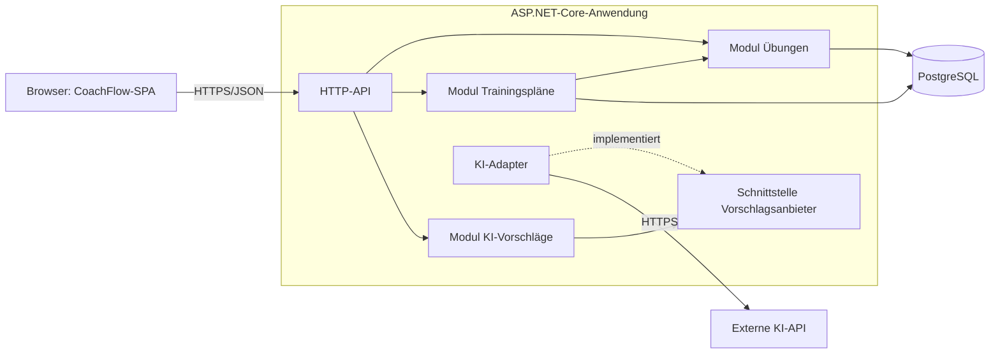

# Architekturentwurf CoachFlow (MVP)

Kennzeichnung: **[V]** Vorgabe, **[A]** eigene Annahme, **[E]** Empfehlung. Der Entwurf wurde weder implementiert noch getestet. Genannte Zahlen sind Startwerte und keine Messergebnisse.

## 1. Vorgaben, offene Punkte und Annahmen

**Vorgaben [V]**
- Es entsteht eine neue Webanwendung ohne Altsystem, zunächst für Volleyball.
- Eine Einheit umfasst Teilnehmerzahl, Erfahrungsniveau, Streuung der Erfahrung, Dauer und höchstens zwei Schwerpunkte.
- Übungen und Pläne lassen sich anlegen, bearbeiten und speichern.
- KI-Vorschläge sind optional, werden vor der Übernahme angezeigt und bleiben bearbeitbar.
- Die Planung funktioniert auch ohne KI-Aufruf.
- Das Backend nutzt C#/.NET.
- Rollen und getrennte Übungsbestände gehören nicht zum Umfang.

**Fehlende Informationen und Annahmen**

| Offener Punkt | Annahme [A] | Auswirkung, falls sie nicht zutrifft |
|---|---|---|
| Ist überhaupt eine Anmeldung nötig? | Es gibt keine Benutzerkonten und einen gemeinsamen Bestand. Der Zugang wird trotzdem zentral geschützt (siehe unten). | Einzelkonten erfordern eine Identitätskomponente. Das Datenmodell bleibt weitgehend gleich. |
| Wie viele Nutzende gibt es, und arbeiten sie gleichzeitig? | Wenige Nutzende, gelegentlich gleichzeitig. | Bei hoher Last wären Skalierung und Hosting neu zu bewerten. |
| Wie sind Niveau und Streuung skaliert? | Je eine feste Stufenliste (z. B. niedrig/mittel/hoch). | Eine andere Skala ändert Datenwerte, Formular und KI-Kontext, aber nicht die Struktur. |
| Sind Schwerpunkte frei oder fest? | Ein fester Katalog für Volleyball (0 bis 2 je Plan). | Freitext erschwert das Filtern und liefert der KI unschärferen Kontext. |
| Wird der Plan automatisch erzeugt? | Nein. Die Nutzenden stellen ihn manuell zusammen. Die KI schlägt nur Übungen vor. | Eine automatische Plangenerierung wäre ein eigenes, deutlich größeres Feature. |
| Muss die Summe der Übungsdauern zur Trainingsdauer passen? | Abweichungen lösen eine Warnung aus, blockieren aber nicht. | Eine harte Regel würde das Speichern von Zwischenständen verhindern. |
| Wird ein Plan mit Datum oder Kalender verknüpft? | Nein. | Ein Kalender käme als Erweiterung hinzu. |
| Welcher KI-Anbieter wird genutzt, und wer trägt die Kosten? | Noch offen. Der Entwurf bleibt anbieterneutral. | Die Wahl beeinflusst Datenschutz, Kosten und Adapter. |
| Sind Alter, Halle und Material relevant? | Sie sind im MVP nicht vorgesehen. | Vorschläge können unpassend sein, etwa für Kinder oder ohne Netz. Das sollte vorab geklärt werden. |
| Wird die Anwendung mobil genutzt? | Sie wird responsiv gebaut, aber nicht offline-fähig. | Offline-Nutzung in der Halle würde das Frontend wesentlich verändern. |

**Zugangsschutz [E]:** Der Ausschluss von Berechtigungen bedeutet nicht, dass die Anwendung offen im Internet stehen sollte. Sonst könnten Fremde Daten ändern und kostenpflichtige KI-Aufrufe auslösen. Ein einfacher gemeinsamer Zugangsschutz genügt, ohne Rollenmodell.

## 2. Empfohlene Architektur

**[E]** Empfohlen wird ein modularer Monolith: eine Single-Page-Anwendung, ein ASP.NET-Core-Backend und eine relationale Datenbank. Das Backend liefert auch das Frontend aus. Damit gibt es nur eine Deployment-Einheit und kein CORS-Thema.

**Pfeilbedeutung:** Ein durchgezogener Pfeil heißt: „Die Quelle ruft das Ziel auf und ist von ihm abhängig.“ Ein gestrichelter Pfeil heißt: „Die Quelle implementiert die Schnittstelle des Ziels.“ Antworten fließen jeweils zurück und sind nicht eingezeichnet.

Entscheidend ist, welche Pfeile fehlen: Die Module Übungen und Trainingspläne hängen nicht vom KI-Modul ab, sodass ein KI-Ausfall die Planung nicht berührt. Das KI-Modul greift zudem nicht auf die Datenbank zu.

| Komponente | Zuständigkeit | Begründung |
|---|---|---|
| SPA | Formulare, Planzusammenstellung, Anzeige und Bearbeitung der Vorschläge | Der Planeditor ist stark interaktiv. |
| HTTP-API | Endpunkte, Eingabeprüfung, Fehlerabbildung, Zugangsschutz, Ratenbegrenzung | Bündelt technische Querschnittsthemen. |
| Modul Übungen | Anlegen, Bearbeiten, Archivieren, Suchen und Filtern | Ist der gemeinsame Baustein für Planung und KI-Übernahme. |
| Modul Trainingspläne | Planparameter, Positionen, fachliche Regeln | Setzt z. B. „höchstens zwei Schwerpunkte“ serverseitig durch. |
| Modul KI-Vorschläge | Eingaben für den Vorschlag aufbereiten, Antwort prüfen, Entwürfe zurückgeben | Hält die KI-Logik vom Kern getrennt und speichert nichts. |
| Schnittstelle und Adapter | Anbieterspezifischer Aufruf, Timeout, Abbildung der Fehler | Ein Anbieterwechsel bleibt lokal, und Tests laufen ohne echte KI. |
| PostgreSQL | Dauerhafte Speicherung | Die Daten sind klar relational. |

Der API-Schlüssel liegt ausschließlich im Backend. Ist keine KI konfiguriert, blendet die SPA die Funktion aus.

## 3. Datenmodell in Grundzügen

| Entität | Wesentliche Felder |
|---|---|
| **Übung** | Id, Sportart, Name, Beschreibung, Standarddauer, geeignete Teilnehmerzahl von/bis (optional), Niveau (optional), Herkunft (eigen/KI), archiviert, Version, Zeitstempel |
| **Schwerpunkt** | Id, Sportart, Bezeichnung |
| **Trainingsplan** | Id, Sportart, Titel, Teilnehmerzahl, Erfahrungsniveau, Streuung der Erfahrung, Dauer in Minuten, Notiz, Version, Zeitstempel |
| **Planposition** | Id, PlanId, ÜbungId, Reihenfolge, geplante Dauer, Notiz |

**Beziehungen**
- Übung und Schwerpunkt stehen in einer n:m-Beziehung.
- Trainingsplan und Schwerpunkt stehen ebenfalls in einer n:m-Beziehung, mit maximal zwei Einträgen je Plan.
- Ein Trainingsplan hat 0..n Planpositionen, die mit ihm zusammen gespeichert werden.
- Eine Planposition verweist auf genau eine Übung. Eine Übung kann in vielen Plänen vorkommen, auch mehrfach im selben Plan.

**Modellentscheidungen [E]**
- Die Parameter der Einheit liegen direkt im Plan. **[A]** Eine Trainingseinheit entspricht also einem Plan.
- Die Sportart wird mitgeführt, hat vorerst aber nur den Wert „Volleyball“. Das kostet wenig und erleichtert spätere Erweiterungen.
- Verwendete Übungen werden archiviert statt gelöscht, damit Pläne vollständig bleiben.
- Das Feld `Version` erkennt gleichzeitige Änderungen im gemeinsamen Bestand (Optimistic Concurrency).
- Für KI-Vorschläge gibt es keine eigene Tabelle. Ein Vorschlag wird erst bei der Übernahme zur normalen Übung.

## 4. Zwei Abläufe

**A. Planung mit vorhandenen Übungen**
1. Die Nutzerin oder der Nutzer legt einen Plan an und gibt die Parameter ein.
2. Die SPA lädt passende Übungen über `GET /api/exercises`, gefiltert z. B. nach Schwerpunkt und Niveau.
3. Die Auswahl, Reihenfolge, Dauern und Notizen werden in der SPA bearbeitet. Eine Dauerabweichung zeigt sie als Warnung an.
4. Beim Speichern sendet die SPA den ganzen Plan mit `POST` oder `PUT /api/plans`.
5. Das Backend prüft die Regeln und die Existenz der Übungen und speichert alles in einer Transaktion.
6. Bei einer veralteten Version antwortet es mit `409`, und die SPA zeigt den Konflikt an.

Dieser Ablauf berührt das KI-Modul an keiner Stelle.

**B. Anforderung und Übernahme eines KI-Vorschlags**
1. Im Planeditor wird „Übungen vorschlagen“ gewählt.
2. Die SPA sendet die Parameter an `POST /api/exercise-suggestions`.
3. Das Backend prüft die Ratenbegrenzung und erstellt den Prompt nur aus den Trainingsparametern.
4. Der Adapter ruft die KI-API mit Timeout auf und fordert eine strukturierte Antwort an.
5. Das Backend prüft die Antwort gegen ein Schema und gibt Entwürfe zurück. **Dabei wird nichts gespeichert.**
6. Die SPA zeigt die Entwürfe als solche gekennzeichnet an. Sie lassen sich bearbeiten oder verwerfen.
7. Bei der Übernahme nutzt die SPA den normalen Weg `POST /api/exercises`, mit Herkunft „KI“. Dieselben Prüfregeln gelten also auch hier.
8. Die neue Übung kann optional direkt in den Plan aufgenommen werden. Gespeichert wird der Plan wie in Ablauf A.

Bei Timeout, Limit oder ungültiger Antwort meldet die API einen verständlichen Fehler. Der Plan im Editor bleibt erhalten und kann normal weiterbearbeitet werden.

## 5. Technologieentscheidungen und Alternative

| Bereich | Empfehlung [E] | Begründung |
|---|---|---|
| Backend | ASP.NET Core (aktuelle LTS-Version) | **[V]** C#/.NET. LTS passt zu einem längeren Betrieb. |
| API | REST/JSON mit OpenAPI | Einfach zu testen, und der TypeScript-Client lässt sich generieren. |
| Datenzugriff | EF Core mit Migrationen | Standardweg in .NET und für dieses einfache Modell ausreichend. |
| Datenbank | PostgreSQL | Relationale Daten, robuste gleichzeitige Schreibzugriffe, verbreitet als Managed Service. |
| Frontend | React mit TypeScript und Vite | Großes Ökosystem, auch für Drag-and-drop und Formulare. |
| KI-Anbindung | Eigener Adapter hinter einer Schnittstelle | Der Anbieter ist offen, und der Austausch bleibt günstig. |
| Betrieb | Ein Container plus Managed-Datenbank | Geringer Betriebsaufwand. Die konkrete Plattform ist noch offen. |

**Ernsthafte Alternative: Blazor Web App statt React-SPA**

| Kriterium | React + ASP.NET-API | Blazor Web App |
|---|---|---|
| Sprachen | Zwei (TypeScript, C#) | Durchgängig C# |
| Build und Abhängigkeiten | Zwei Toolchains | Eine Toolchain |
| Validierung und Modelle | Über den generierten Client geteilt, Regeln teils doppelt | Direkt gemeinsam nutzbar |
| UI-Ökosystem | Sehr groß | Kleiner, aber für Formulare ausreichend |
| Verhalten bei instabiler Verbindung | Unkritisch, da die UI im Browser läuft | Im interaktiven Servermodus heikel, weil die UI eine dauerhafte Verbindung braucht |
| API-Trennung | Von Anfang an klar | Muss bewusst eingehalten werden |

**Abwägung:** Empfohlen bleibt React, weil der Planeditor das interaktivste Element ist und Sporthallen oft schlechtes Netz haben.

Die Entscheidung kippt jedoch, wenn das Team überwiegend C# und wenig TypeScript beherrscht. Dann ist Blazor für diesen MVP die bessere Wahl, möglichst mit clientseitigem Rendering (WebAssembly). Die Teamkompetenz ist unbekannt und sollte vor der Festlegung geklärt werden.

## 6. Risiken, Zielkonflikte und offene Punkte

| Thema | Risiko oder Konflikt | Vorgehen [E] |
|---|---|---|
| Zugang | Ohne Schutz wären Daten und KI-Kosten offen. | Gemeinsamen Zugangsschutz vor dem ersten öffentlichen Deployment umsetzen. |
| KI-Kosten | Wiederholte Aufrufe verursachen unkontrollierte Kosten. | Ratenbegrenzung, Tageslimit und Budgetalarm beim Anbieter einrichten. |
| KI-Qualität und Sicherheit | Vorschläge können fachlich falsch, unpassend oder riskant sein. | Vorschläge prüfen lassen, klar kennzeichnen und mit Fachleuten an Beispielfällen bewerten. |
| KI-Ausgabe | Die Antwort kann fehlerhaft oder schädlich formatiert sein. | Schema prüfen und Inhalte nur als Text darstellen, nie als HTML. |
| Datenschutz | Freitext könnte Personendaten an Dritte übertragen. | Nur strukturierte Parameter senden. Anbieterbedingungen und Verarbeitungsort rechtlich prüfen. |
| Antwortzeit | Ein synchroner Aufruf ist einfach, kann aber lange blockieren. | Für den MVP synchron mit Timeout und Ladeanzeige bauen. Die Antwortzeit real messen und bei Bedarf auf Streaming oder Polling umstellen. |
| Vorschläge ohne Speicherung | Einfach, aber beim Neuladen gehen Entwürfe verloren, und es gibt keine Auswertung. | Für den MVP akzeptieren und nach Rückmeldungen neu bewerten. |
| Gemeinsamer Bestand | Änderungen betreffen alle Nutzenden, auch unbeabsichtigt. | Versionsprüfung und Archivieren einsetzen. Die Grenzen im MVP offen benennen. |
| Plan und Übung | Die Änderung einer Übung wirkt auch auf alte Pläne. Eine Kopie pro Plan wäre stabil, aber aufwendiger. | Vorerst per Referenz verknüpfen. Fachlich bestätigen lassen, weil eine spätere Umstellung Migrationsaufwand bedeutet. |
| Datensicherung | Der gemeinsame Bestand ist ein zentraler Wert. | Automatische Backups einrichten und die Wiederherstellung einmal real erproben. |

**Vor der Umsetzung zu klären:** Zugangsschutz, KI-Anbieter und Budget, Teamkompetenz, Skalen und Schwerpunktkatalog, Bedeutung von Alter und Material sowie das Verhalten alter Pläne bei Übungsänderungen.

## 7. Erste Umsetzungsschritte und empfohlene Prüfungen

**Schritte**
1. Die offenen Punkte klären und die Entscheidungen kurz als Architecture Decision Records festhalten.
2. Das Grundgerüst mit CI, Datenbankmigration, Zugangsschutz und erstem Deployment aufsetzen.
3. Das Modul Übungen samt Oberfläche umsetzen.
4. Trainingspläne mit Editor und Versionsprüfung bauen. Damit ist der Kern ohne KI nutzbar.
5. Die KI-Anbindung zunächst mit einem Fake-Adapter und der Vorschau-Oberfläche umsetzen.
6. Den echten Adapter mit Limits, Protokollierung ohne sensible Inhalte und Kostenüberwachung anschließen.
7. Den Stand mit einigen echten Trainerinnen und Trainern erproben.

**Empfohlene Prüfungen**
- **Domänentests:** Ein dritter Schwerpunkt wird abgelehnt, und Dauerabweichungen erzeugen nur eine Warnung.
- **Integrationstests:** Sie laufen gegen echtes PostgreSQL, z. B. mit Testcontainers. Geprüft werden Speichern, Transaktionen, Archivieren und der `409`-Konflikt.
- **Adaptertests:** Mit simulierten Antworten werden Timeout, Fehlercode, Limit und ungültiges JSON durchgespielt.
- **Unabhängigkeit von der KI:** Die Anwendung läuft ohne API-Schlüssel und bei ausgefallenem Anbieter, und Ablauf A funktioniert vollständig.
- **Keine Übernahme ohne Bestätigung:** Eine Anforderung allein darf den Bestand nachweislich nicht verändern.
- **End-to-End-Tests:** Beide Abläufe werden im Browser geprüft, z. B. mit Playwright, auch auf Smartphone-Breite.
- **Sicherheit:** Der Schlüssel taucht nie im Frontend oder in Logs auf, Inhalte werden nur als Text dargestellt, und der Zugang ist ohne Anmeldung gesperrt.
- **KI-Qualität:** Vorschläge zu festen Beispielfällen werden von Fachleuten bewertet, auch nach Modellwechseln.
