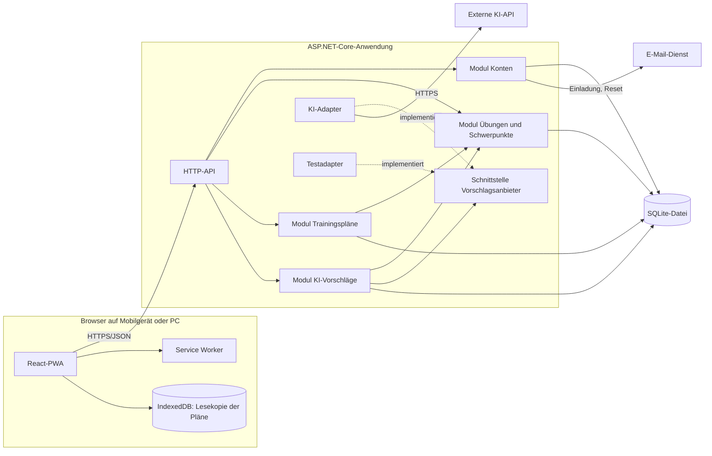

# Architektur CoachFlow (MVP), überarbeitete Fassung

Kennzeichnung: **[V]** Vorgabe oder deine Entscheidung, **[A]** eigene Annahme, **[E]** Empfehlung. IDs wie K1 oder R6 verweisen auf deine Tabelle. Der Entwurf wurde weder implementiert noch getestet.

## 1. Vorgaben, offene Punkte und Annahmen

**Festgelegte Vorgaben [V]**

| Thema | Entscheidung |
|---|---|
| Konten | Einfache persönliche Konten, Erstellung nur per Einladung. Passwort-Reset per E-Mail. Keine Rollen. |
| Nutzung | 50 Personen insgesamt, 5 gleichzeitig, auf Mobilgeräten und PCs. |
| Bestand | Übungen und Pläne sind gemeinsam. Alle Nutzenden dürfen alles sehen und bearbeiten. |
| Parameter | Niveau: Mini-Volleyball, Midi-Volleyball, Anfänger, Fortgeschrittene. Streuung: gering, mittel, hoch. |
| Schwerpunkte | Vorbefüllter gemeinsamer Katalog, von allen erweiterbar. 0 bis 2 je Plan. |
| Planung | Manuelle Zusammenstellung, ergänzt durch KI-Übungen. Dauerabweichung nur als Warnung. Kein Kalender. |
| Übungsstand | Ein Plan behält seinen Stand, auch wenn die Übung später geändert wird. |
| Offline | Gespeicherte Pläne lassen sich offline ansehen. Bearbeitet wird nur online. |
| KI-Anbieter | Noch offen, serverseitig austauschbar. Für erste Tests dient ein Testadapter mit vorbereiteten Antworten. |
| KI-Limits | Je Nutzer eine gleichzeitige Anfrage und fünf pro Minute. Monatsbudget einstellbar, Betrag offen. |
| KI-Wartezeit | Ladeanzeige mit Abbruch, Hinweis nach 5 Sekunden, Ende spätestens nach 15 Sekunden. |
| KI-Daten | Keine personenbezogenen Daten. Das Antwortformat wird geprüft, eine fachliche Prüfung entfällt. |
| Datenverlust | Keine Backups und keine Wiederherstellung im MVP. |
| Nicht im Umfang | Alter, Halle, Material. Nicht übernommene Vorschläge dürfen beim Neuladen verloren gehen. |

**Verbleibende Annahmen**

| Annahme [A] | Auswirkung, falls sie nicht zutrifft |
|---|---|
| Alle angemeldeten Nutzenden dürfen einladen. Das erste Konto wird beim Einrichten angelegt. | Dürfen das nur Betreibende, braucht es doch eine einfache Sonderrolle oder ein Skript. |
| Konten werden technisch von den Betreibenden deaktiviert, nicht in der Oberfläche. | Sonst käme eine Verwaltungsansicht hinzu. |
| Schwerpunkte können nur ergänzt werden, nicht umbenannt oder gelöscht. | Umbenennen würde bestehende Pläne und Übungen mitverändern. |
| Der kopierte Übungstext im Plan ist nicht editierbar. Dauer und Notiz der Position sind es. | Editierbare Texte vergrößern den Planeditor. |
| Eine KI-Anfrage liefert wenige Vorschläge, z. B. drei. | Mehr Vorschläge erhöhen Kosten und Antwortzeit. |
| Abgebrochene KI-Anfragen zählen für das Limit. | Sonst ließe sich das Limit umgehen. |

**Noch offen, aber nicht blockierend:** KI-Anbieter, Budgetbetrag und Kostenträger, E-Mail-Dienst, Hosting.

## 2. Empfohlene Architektur

**[E]** Empfohlen wird ein modularer Monolith mit einer React-PWA (installierbare Web-App). Ein einzelner Container liefert API und Frontend aus. Das passt zu 5 gleichzeitigen Personen, muss aber im Betrieb noch bestätigt werden.

**Pfeilbedeutung:** Ein durchgezogener Pfeil heißt: „Die Quelle ruft das Ziel auf und ist von ihm abhängig.“ Ein gestrichelter Pfeil heißt: „Die Quelle implementiert die Schnittstelle des Ziels.“ Antworten fließen jeweils zurück und sind nicht eingezeichnet.

Weiterhin fehlt jeder Pfeil von Übungen oder Plänen zum KI-Modul. Ein KI-Ausfall berührt die Planung also nicht. Das KI-Modul nutzt die Datenbank nur für Nutzungs- und Kostendaten.

| Komponente | Zuständigkeit | Begründung |
|---|---|---|
| React-PWA | Oberfläche, Planeditor, Vorschlagsanzeige, Offline-Lesemodus | Der Planeditor ist interaktiv, und der Offline-Modus muss im Browser laufen. |
| Service Worker | Zwischenspeichern der App-Dateien | Die App startet dadurch auch ohne Netz. |
| IndexedDB | Lokale Lesekopie aller Pläne | Bleibt auf dem Gerät erhalten. Zugriff nur über gezielten Abgleich, nicht über pauschales API-Caching. |
| HTTP-API | Endpunkte, Prüfung der Anmeldung, Ratenbegrenzung, Fehlerabbildung | Bündelt Querschnittsthemen. |
| Modul Konten | Einladung, Anmeldung, Passwort-Reset | Schützt Daten und KI-Kosten (R1). |
| Modul Übungen und Schwerpunkte | Verwaltung, Filter, Katalogerweiterung | Grundlage für Pläne und Vorschläge. |
| Modul Trainingspläne | Plan und Positionen, Kopie des Übungsstands, Schwerpunktregel | Fachlicher Kern. |
| Modul KI-Vorschläge | Budgetprüfung, Prompt, Antwortprüfung, Nutzungserfassung | Hält KI-Logik und Kostenkontrolle getrennt. |
| Adapter | Anbieteraufruf bzw. vorbereitete Testantworten | Tests laufen ohne Anbieter, und der Wechsel bleibt lokal. |

## 3. Datenmodell in Grundzügen

| Entität | Wesentliche Felder |
|---|---|
| **Benutzer** | Id, E-Mail, Name, Passwort-Hash, aktiv |
| **Einladung** | Id, E-Mail, Token-Hash, Ablaufzeit, eingelöst am, eingeladen von |
| **Übung** | Id, Sportart, Name, Beschreibung, Standarddauer, Teilnehmerzahl von/bis (optional), Niveau (optional), Herkunft (eigen/KI), Version, geändert von/am |
| **Schwerpunkt** | Id, Sportart, Bezeichnung, normalisierte Bezeichnung (eindeutig), angelegt von |
| **Trainingsplan** | Id, Sportart, Titel, Teilnehmerzahl, Niveau, Streuung, Dauer, Notiz, Version, geändert von/am |
| **Planposition** | Id, PlanId, Reihenfolge, ÜbungId (optional), kopierter Name, kopierte Beschreibung, geplante Dauer, Notiz |
| **KI-Nutzung** | Id, BenutzerId, Zeitpunkt, Ergebnis, Tokenmengen, geschätzte Kosten |

**Beziehungen**
- Übung und Schwerpunkt stehen in einer n:m-Beziehung.
- Trainingsplan und Schwerpunkt stehen in einer n:m-Beziehung, mit maximal zwei Einträgen je Plan.
- Ein Plan hat 0..n Positionen, die zusammen mit ihm gespeichert werden.
- Eine Position verweist optional auf ihre Ursprungsübung.

**Modellentscheidungen [E]**
- **Übungsstand:** Die Kopie entsteht serverseitig beim ersten Speichern einer Position. Bestehende Positionen bleiben danach unverändert.
- **Löschen:** Die Kopie macht ein Archivieren überflüssig. Übungen werden wirklich gelöscht, der Verweis wird leer, und Pläne bleiben vollständig. Die Oberfläche fragt vorher nach, denn eine Wiederherstellung gibt es nicht (R8).
- **Offline:** Da Pläne ihre Inhalte selbst enthalten, genügt die Lesekopie ohne Übungsbestand.
- **Gleichzeitigkeit:** Pläne und Übungen werden gemeinsam bearbeitet. Das Feld `Version` verhindert unbemerktes Überschreiben.
- **Doppelte Schwerpunkte:** Die normalisierte Bezeichnung verhindert Varianten wie „Annahme“ und „annahme“.
- **Umgesetzt in Schritt 3 [A]:** Der Startkatalog umfasst Aufwärmen, Pritschen, Baggern, Aufschlag, Annahme, Zuspiel, Angriff, Block, Feldabwehr, Spielverständnis, Koordination und Athletik. Eine Übung ohne Niveau oder ohne Teilnehmergrenzen gilt als passend für jede Auswahl. Der Schwerpunktfilter findet Übungen mit mindestens einem der gewählten Schwerpunkte. Die Suche ignoriert Groß- und Kleinschreibung, auch bei Umlauten. Grenzen: Name höchstens 120 Zeichen, Beschreibung höchstens 4000 Zeichen, Dauer 1 bis 180 Minuten, Teilnehmende 1 bis 100. Die Regel „0 bis 2 Schwerpunkte“ gilt nur für Pläne, Übungen dürfen beliebig viele haben.
- **Umgesetzt in Schritt 4 [A]:** Ein Plan speichert alle Positionen in einem Rutsch. Positionen mit Id behalten ihren kopierten Text, Positionen ohne Id entstehen aus einer Übung samt Kopie, fehlende Positionen werden entfernt. Niveau, Streuung, Teilnehmerzahl und Dauer sind Pflicht. Grenzen: Dauer 1 bis 300 Minuten, höchstens 50 Übungen je Plan, Notiz höchstens 2000 Zeichen. Jede Position braucht eine Ursprungsübung, freie Einträge wie „Trinkpause“ gibt es noch nicht. Die Planliste liefert vollständige Pläne, weil Schritt 5 daraus die Offline-Lesekopie bildet.
- **Umgesetzt in Schritt 5 [A]:** Die Kopie wird bei jedem Laden der Planliste, nach jeder Anmeldung und nach jedem Speichern oder Löschen eines Plans ersetzt. Sie gehört zu genau einem Konto und wird beim Abmelden und bei einer abgelaufenen Anmeldung (401) gelöscht. Als „keine Verbindung“ gelten auch Serverfehler ab 500 und Anfragen, die nach 8 Sekunden noch nicht beantwortet sind. Startet die App ohne Verbindung, öffnet sie mit der Kopie im Lesemodus. Abmelden braucht eine Verbindung, weil nur der Server das Anmelde-Cookie löschen kann. Der Browser wird um dauerhaften Speicher gebeten, eine Garantie gibt es nicht.
- **Umgesetzt in Schritt 6 [A]:** Eine Anfrage liefert bis zu 3 Vorschläge. Einzelne unbrauchbare Einträge fallen weg, ist keiner brauchbar, kommt eine Fehlermeldung. Eine übernommene Übung erhält Niveau und Schwerpunkte des Plans und die Herkunft „KI“. Das Budget gilt je Kalendermonat in UTC und wird vor jeder Anfrage geprüft. Gleichzeitige Anfragen mehrerer Personen können es deshalb knapp überschreiten. Abgelehnte Anfragen zählen nicht für das Minutenlimit, gestartete und abgebrochene schon. Die Limits liegen im Speicher, ein Neustart setzt sie zurück. Außerhalb der Entwicklung ist die Funktion abgeschaltet, bis ein Anbieter eingerichtet ist.

## 4. Abläufe

**A. Planung mit vorhandenen Übungen**
1. Die Person meldet sich an und legt einen Plan mit Parametern an.
2. Bei Bedarf ergänzt sie einen neuen Schwerpunkt im Katalog.
3. Die SPA lädt passende Übungen über `GET /api/exercises`.
4. Auswahl, Reihenfolge, Dauern und Notizen werden bearbeitet. Eine Dauerabweichung erscheint als Warnung.
5. Die SPA speichert den Plan mit `POST` oder `PUT /api/plans`.
6. Das Backend prüft die Regeln, kopiert den Stand neuer Übungen und speichert alles in einer Transaktion.
7. Bei einer veralteten Version antwortet es mit `409`. Die SPA behält die Eingaben und bietet an, den aktuellen Stand zu laden. Es gibt keine automatische Zusammenführung.

**B. Anforderung und Übernahme eines KI-Vorschlags**
1. Die Person wählt „Übungen vorschlagen“. Offline ist die Funktion deaktiviert.
2. Die SPA sendet die Parameter an `POST /api/exercise-suggestions` und zeigt die Ladeanzeige mit „Anfrage abbrechen“.
3. Das Backend prüft das Monatsbudget und je Nutzer die Grenzen aus R2. Überschreitungen lehnt es mit einer verständlichen Meldung ab.
4. Der Prompt enthält nur Teilnehmerzahl, Niveau, Streuung, Dauer und Schwerpunktnamen, keine Konto- oder Plannotizdaten.
5. Der Adapter ruft die KI auf. Ein Abbruch in der SPA beendet auch diesen Aufruf.
6. Nach 5 Sekunden erscheint: „Die Erstellung dauert länger. Du kannst weiter warten oder abbrechen.“
7. Nach spätestens 15 Sekunden endet das Warten mit: „Es konnte rechtzeitig kein Übungsvorschlag erstellt werden. Deine Eingaben bleiben erhalten.“ **[E]** Das Backend bricht etwas früher ab, damit es noch eine geordnete Antwort senden kann.
8. Das Backend prüft die Antwort gegen das Schema, erfasst die Nutzung und liefert Entwürfe. **Übungen werden dabei nicht gespeichert.**
9. Die SPA zeigt die Entwürfe als reinen Text. Sie lassen sich bearbeiten oder verwerfen.
10. Bei der Übernahme nutzt die SPA `POST /api/exercises` mit Herkunft „KI“ und kann die Übung in den Plan aufnehmen.

**C. Pläne offline ansehen**
1. Bei bestehender Verbindung lädt die App beim Start und nach Änderungen eine Lesekopie aller Pläne und ersetzt die lokale Kopie.
2. Ohne Netz startet sie aus dem Service Worker und zeigt die Pläne aus IndexedDB mit dem Hinweis „Offline, Stand: Datum und Uhrzeit“.
3. Bearbeiten und KI-Funktionen sind dann deaktiviert.
4. Beim Abmelden löscht die App die lokale Kopie.

## 5. Technologieentscheidungen und Alternative

| Bereich | Empfehlung [E] | Begründung |
|---|---|---|
| Backend | ASP.NET Core, aktuelle LTS-Version | **[V]** C#/.NET. |
| Konten | ASP.NET Core Identity mit HttpOnly-Cookie | Bewährtes Passwort-Handling. Gleicher Ursprung, also kein Token im Browser-Speicher. |
| Kontoregeln (umgesetzt in Schritt 2) | Passwort mindestens 10 Zeichen ohne Zeichenregeln. Einladung 3 Tage, Reset-Link 2 Stunden gültig, beide nur einmal nutzbar. Sperre für 15 Minuten nach 5 Fehlversuchen, höchstens 10 Anmeldeanfragen pro Minute und Adresse. Anmeldung bleibt 14 Tage gültig. Erstes Konto per Kommandozeile. | Länge schützt besser als Sonderzeichenregeln (NIST SP 800-63B). Die Werte sind einstellbar. |
| Ratenbegrenzung | Eingebaute ASP.NET-Rate-Limiter je Benutzer | Reicht bei einer Instanz. Bei mehreren Instanzen müsste sie zentralisiert werden. |
| Datenzugriff | EF Core mit Migrationen | Standardweg in .NET. |
| Datenbank | SQLite, als Datei auf einem dauerhaften Volume | Kein Datenbankserver nötig, lokal ohne Docker nutzbar. Reicht für wenige Nutzende mit einer Instanz. Entschieden am 08.11.2026 statt PostgreSQL. |
| Frontend | React, TypeScript, Vite | K11 lässt beides zu. Das Ökosystem ist für Editor und PWA am stärksten. |
| Offline | PWA mit Service Worker und IndexedDB | Webstandard, kein separater App-Store-Weg. |
| API | REST/JSON mit OpenAPI | Der TypeScript-Client lässt sich generieren. |
| E-Mail | Transaktionsdienst per SMTP oder API, hinter einer Schnittstelle | Der Dienst bleibt austauschbar. |
| Betrieb | Ein Container mit dauerhaftem Volume für die Datenbankdatei, genau eine Instanz, HTTPS | HTTPS ist für den Service Worker Pflicht. Ohne dauerhaftes Volume gehen alle Daten beim Neustart verloren. |

**Ernsthafte Alternative: Blazor WebAssembly als PWA**

| Kriterium | React-PWA | Blazor-WebAssembly-PWA |
|---|---|---|
| Sprachen | TypeScript und C# | Durchgängig C# |
| Gemeinsame Modelle | Über generierten Client | Direkt geteilt |
| Erster Ladevorgang mobil | Tendenziell kleiner | Tendenziell größer durch die .NET-Runtime |
| Offline-Speicher | IndexedDB direkt nutzbar | Meist über JavaScript-Interop oder Zusatzbibliotheken |
| Touch-Editor | Viele ausgereifte Bibliotheken | Geringere Auswahl |

Interaktives Server-Blazor scheidet durch die Offline-Vorgabe aus. WebAssembly bleibt eine tragfähige Option.

**Abwägung:** Empfohlen bleibt React, weil mobile Ladezeit, Offline-Speicher und Touch-Bedienung hier wichtiger sind als eine einheitliche Sprache. Die Einschätzung zur Ladezeit ist nicht gemessen und sollte bei Zweifeln mit einem kurzen Prototyp geprüft werden.

## 6. Risiken, Zielkonflikte und offene Punkte

**Zu behandeln**

| Thema | Risiko oder Konflikt | Vorgehen [E] |
|---|---|---|
| 15-Sekunden-Grenze | Je nach Anbieter und Modell kann sie oft überschritten werden. | Beim Anbietervergleich real messen. Wenige Vorschläge und kurze Texte anfordern. |
| Freie Schwerpunkte und R5 | Nutzertext gelangt in den Prompt und könnte Namen enthalten. | Länge begrenzen, Hinweis im Formular. Kein absoluter Schutz, daher bewusst entscheiden. |
| Budget | Ohne Betrag kann der echte Adapter nicht aktiv werden. | Solange der Betrag fehlt, nur den Testadapter nutzen. Zusätzlich ein Limit beim Anbieter setzen, falls möglich. |
| Budgetgrenze | Gleichzeitige Anfragen können das Limit knapp überschreiten. | Bei 5 Personen akzeptabel. Limit etwas unter dem echten Budget ansetzen. |
| Offline-Stand | Andere können den Plan zwischenzeitlich geändert haben. | Stand sichtbar anzeigen. Ein Überschreiben ist ausgeschlossen, da offline nur gelesen wird. |
| Lokale Speicherung | Browser, besonders auf iOS, können Offline-Daten entfernen. Daten bleiben bis zur Abmeldung auf dem Gerät. | Dauerhaften Speicher anfragen und auf echten Geräten prüfen. Nutzung als installierte App empfehlen. |
| Gemeinsame Pläne | Alle können fremde Pläne ändern oder löschen, ohne Wiederherstellung. | Versionsprüfung, Löschbestätigung, Anzeige von „geändert von“. |
| Konten | E-Mail-Adressen sind personenbezogene Daten. Es entsteht Pflege für Einladungen und Resets. | Datenschutzhinweis, Löschprozess und Verantwortliche vor dem Start klären. |
| Einladungsrecht | Jeder kann einladen, und jedes Konto verursacht KI-Kosten. | Budget deckelt den Schaden. Token kurzlebig und einmalig gestalten. |

**Bewusst akzeptiert [V]**
- **Ohne Backups** kann ein Fehler den gesamten Bestand einschließlich der Konten vernichten. Bei SQLite steckt der Bestand in einer Datei auf dem Volume. Bietet der Hosting-Dienst Volume-Snapshots an, sollten sie aktiv bleiben. Das erfordert keine weitere Architektur.
- **SQLite statt PostgreSQL** bindet das MVP an eine einzige Instanz, da nur ein Schreibvorgang gleichzeitig möglich ist. Ein späterer Wechsel zu PostgreSQL erfordert neue Migrationen und eine einmalige Datenübernahme.
- **Ohne fachliche Prüfung** sind die Nutzenden allein verantwortlich für KI-Übungen, auch im Mini-Bereich mit Kindern.
- **Nicht übernommene Vorschläge** gehen beim Neuladen verloren.

## 7. Erste Umsetzungsschritte und empfohlene Prüfungen

**Schritte**
1. Grundgerüst mit CI, Migrationen, HTTPS-Deployment und PWA-Hülle aufsetzen.
2. Konten mit Einladung und Passwort-Reset umsetzen.
3. Übungen und Schwerpunktkatalog bauen.
4. Trainingspläne mit Positionskopie, Editor und Versionsprüfung umsetzen. Damit ist der Kern nutzbar.
5. Offline-Lesekopie ergänzen.
6. KI-Ablauf mit Testadapter umsetzen, einschließlich Limits, Abbruch und Meldungen.
7. KI-Anbieter auswählen, Antwortzeit und Kosten messen, Budget festlegen und echten Adapter aktivieren.
8. Mit einigen Trainerinnen und Trainern auf Smartphones in echten Hallen erproben.

**Empfohlene Prüfungen**
- **Domänentests:** Ein dritter Schwerpunkt wird abgelehnt, Dauerabweichungen erzeugen nur eine Warnung, und doppelte Schwerpunkte werden verhindert.
- **Übungsstand:** Das Ändern oder Löschen einer Übung lässt bestehende Pläne unverändert.
- **Integrationstests gegen eine echte SQLite-Datei:** Transaktionen und `409`-Konflikte bei Plänen und Übungen werden geprüft. Jeder Test nutzt eine eigene temporäre Datenbank.
- **Konten:** Ohne Einladung gibt es kein Konto, Tokens funktionieren nur einmal und laufen ab, und API-Zugriffe ohne Anmeldung werden abgewiesen.
- **KI-Limits:** Die zweite parallele Anfrage, die sechste Anfrage pro Minute und ein erschöpftes Budget werden abgelehnt.
- **KI-Zeitverhalten:** Der Hinweis nach 5 Sekunden, das Ende nach 15 Sekunden, der Abbruch und erhaltene Eingaben werden mit verzögerten Testantworten geprüft.
- **KI-Fehlerfälle:** Ungültiges JSON, Fehlercodes und Anbieter-Limits erzeugen verständliche Meldungen.
- **Keine Übernahme ohne Bestätigung:** Eine Anforderung allein verändert den Bestand nicht.
- **Unabhängigkeit von der KI:** Ablauf A funktioniert ohne Schlüssel und bei Anbieterausfall.
- **Datenschutz:** Ein Test prüft die ausgehende Anfrage auf das erlaubte Feldset. Schlüssel erscheinen nicht im Frontend oder in Logs.
- **Offline:** Auf Android, iOS und PC werden Start im Flugmodus, Stand-Anzeige, gesperrtes Bearbeiten und das Löschen beim Abmelden geprüft.
- **End-to-End-Tests:** Die Abläufe A bis C werden im Browser geprüft, auch auf Smartphone-Breite.
- **Lastprobe:** Fünf gleichzeitige Personen werden simuliert, um die Einschätzung zur Einzelinstanz zu bestätigen.
